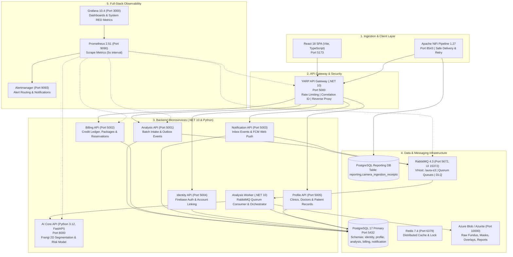

# AURA — Nền Tảng Y Tế Số Sàng Lọc Sức Khỏe Mạch Máu Võng Mạc

> **Mã đề tài**: `SP26SE025`  
> **Dự án**: AURA (Automated Retinal Vascular Health Screening Platform)  
> **Repository**: `XD-PMHDT` · **Jira Project**: `SCRUM`  
> **Trạng thái hiện tại**: Hoàn tất 100% Sprint 3 (21/21 Tasks `SCRUM-317`–`SCRUM-337`) · Đang triển khai Sprint 4 MVP (`SCRUM-338`–`SCRUM-361`).

---

## 1. Tổng Quan Dự Án & Mục Tiêu Y Tế

**AURA** là hệ thống y tế số ứng dụng Thị giác Máy tính (Computer Vision) và Kiến trúc Hướng Dịch vụ (Microservices Architecture) nhằm hỗ trợ bác sĩ và phòng khám tầm soát sớm các bệnh lý tổn thương mạch máu vi thể (bệnh võng mạc đái tháo đường, tăng huyết áp võng mạc, tắc nghẽn tĩnh mạch võng mạc):

1. **Phân vùng mạng lưới mạch máu (Vessel Segmentation)**: Sử dụng thuật toán lọc Frangi 2D đa tỷ lệ kết hợp trích xuất hình thái (morphological skeletonization) để đo lường định lượng mật độ mạch máu (`vessel_density`) và chỉ số uốn lượn cong queo (`tortuosity_index`).
2. **Tiếp nhận & Xử lý Batch từ Camera Y tế**: Tích hợp luồng tiếp nhận công nghiệp qua **Apache NiFi 1.27** hỗ trợ xử lý hàng loạt ($\ge 100$ ảnh), khử trùng lặp dữ liệu (SHA-256 deduplication), cách ly dữ liệu lỗi (Quarantine Isolation) và tự phục hồi khi mạng/database gián đoạn (Bounded Retry & Zero Data Loss).
3. **Không gian làm việc Bác sĩ (Doctor Review Workspace)**: So sánh ảnh gốc với lớp phủ mạch máu, cho phép bác sĩ điều chỉnh kết luận chẩn đoán (Optimistic Locking) và kết xuất bệnh án điện tử / báo cáo y khoa dạng PDF.
4. **Mô hình Đa Khách thuê (Multi-tenant Clinic)**: Quản lý tổ chức y tế, phòng khám độc lập, phân quyền bác sĩ khám bệnh, cô lập tuyệt đối dữ liệu bệnh nhân giữa các tổ chức.
5. **Quản lý Hạn ngạch & Thông báo Tức thời**: Ledger trừ credit giao dịch an toàn (ACID + Idempotency), tích hợp Firebase Cloud Messaging (FCM Web Push) gửi thông báo hoàn thành kết quả theo thời gian thực.

---

## 2. Kiến Trúc Kỹ Thuật Toàn Cảnh (Architecture Overview)



---

## 3. Công Nghệ & Thành Phần Hệ Thống

| Thành phần | Công nghệ chủ đạo | Vai trò / Trách nhiệm chính |
|---|---|---|
| **Web Frontend** | React 18, TypeScript, Vite, Tailwind CSS | Giao diện Upload, theo dõi tiến độ Batch, Workspace bác sĩ, nhận Web Push. |
| **API Gateway** | ASP.NET Core (.NET 10), YARP | Reverse proxy, điều phối định tuyến, xác thực Firebase JWT, Rate limiting, Correlation ID. |
| **Identity API** | ASP.NET Core (.NET 10), Firebase Admin | Xác thực người dùng, liên kết hồ sơ bệnh nhân/bác sĩ, ký và cấp phát token nội bộ. |
| **Profile API** | ASP.NET Core (.NET 10), EF Core | Quản lý đa tổ chức (Multi-tenant Clinics), phân công bác sĩ, danh bạ bệnh nhân. |
| **Analysis API** | ASP.NET Core (.NET 10), EF Core, Npgsql | Tiếp nhận lượt upload, kiểm tra tệp nhị phân, lưu trữ đợt phân tích (Outbox Pattern). |
| **Analysis Worker** | .NET 10 Worker Service, RabbitMQ.Client | Tiêu thụ thông điệp hàng đợi Quorum Queue, tải ảnh từ Blob, gọi AI Core, ghi nhận kết quả. |
| **AI Core** | Python 3.12, FastAPI, OpenCV, NumPy, SciPy | Phân vùng mạch máu bằng bộ lọc Frangi 2D, trích xuất đặc trưng hình thái, tính toán rủi ro. |
| **Billing API** | ASP.NET Core (.NET 10), EF Core | Quản lý số dư Credit, đặt trước (Reservation), thanh quyết toán Idempotent, gói cước Clinic. |
| **Notification API**| ASP.NET Core (.NET 10), RabbitMQ Consumer | Hộp thư thông báo (Notification Inbox), tiếp nhận sự kiện hoàn tất phân tích, gửi FCM Push. |
| **Camera Ingestion**| Apache NiFi 1.27, Groovy Scripting | Hấp thụ ảnh từ camera y tế, phát hiện xung đột SHA-256, cách ly ảnh hỏng, tự thử lại có giới hạn. |
| **Cơ sở dữ liệu** | PostgreSQL 17, Redis 7.4 | Lưu trữ dữ liệu quan hệ (PostgreSQL) và bộ nhớ đệm phân tán / khóa lạc quan (Redis). |
| **Lưu trữ đối tượng**| Azure Blob Storage / Azurite 3.33.0 | Lưu trữ tệp ảnh gốc, ảnh mặt nạ phân vùng (Mask), ảnh lớp phủ (Overlay) và báo cáo PDF. |
| **Giám sát & Cảnh báo**| Prometheus 2.51, Grafana 10.4, Alertmanager | Thu thập chỉ số hiệu năng (RED metrics), bảng điều khiển tổng thể, cảnh báo sự cố. |

---

## 4. Danh Mục Cổng & Địa Chỉ Dịch Vụ (Service & Port Registry)

| Dịch vụ / Ứng dụng | Host / Port Local | Giao thức / Đường dẫn mặc định | Ghi chú |
|---|---|---|---|
| **Web Frontend (Vite)** | `http://localhost:5173` | HTTP / SPA | Giao diện người dùng AURA Web |
| **API Gateway** | `http://127.0.0.1:5000` | HTTP / Reverse Proxy | Điểm vào duy nhất cho toàn bộ API |
| **Analysis API** | `http://127.0.0.1:5001` | HTTP / REST (`/api/v1/analyses`) | Quản lý phân tích & tiếp nhận batch |
| **Billing API** | `http://127.0.0.1:5002` | HTTP / REST (`/api/v1/billing`) | Quản lý ví tín dụng & hạn ngạch |
| **Notification API** | `http://127.0.0.1:5003` | HTTP / REST (`/api/v1/notifications`) | Hộp thư thông báo & đẩy FCM |
| **Identity API** | `http://127.0.0.1:5004` | HTTP / REST (`/api/v1/identity`) | Định danh & liên kết tài khoản |
| **Profile API** | `http://127.0.0.1:5005` | HTTP / REST (`/api/v1/profiles`) | Quản lý Tenant, Bác sĩ & Bệnh nhân |
| **AI Core Service** | `http://127.0.0.1:8000` | HTTP / REST (`/api/v1/segment`) | Dịch vụ AI Frangi 2D |
| **Apache NiFi Canvas** | `https://localhost:8543/nifi` | HTTPS (Admin: `aura-s3-admin`) | Pipeline tiếp nhận Camera Ingestion |
| **RabbitMQ Management** | `http://127.0.0.1:15372` | HTTP UI (Guest / Admin) | Quản lý Quorum Queues, Exchanges, DLQ |
| **RabbitMQ AMQP** | `amqp://127.0.0.1:5672` | TCP (AMQP 0-9-1) | VHost: `/aura-s3` |
| **PostgreSQL Primary** | `localhost:5432` | TCP / PostgreSQL 17 | DB: `aura` (Schemas: identity, profile, ...) |
| **Azurite Blob Storage**| `http://127.0.0.1:10000` | HTTP / Blob Service | Giả lập Azure Blob Storage nội bộ |
| **Redis Cache** | `localhost:6379` | TCP / Redis 7.4 | Caching & Distributed Locks |
| **Prometheus** | `http://localhost:9090` | HTTP UI / Metrics Scraper | Cụm quan sát & đo lường hiệu năng |
| **Grafana** | `http://localhost:3000` | HTTP UI (Admin / Dashboards) | Bảng điều khiển giám sát tổng quan |

---

## 5. Tiến Độ Dự Án & Bản Đồ Phân Công Jira (`SCRUM`)

Dự án vận hành theo phương pháp Scrum với công cụ quản lý Jira (`SCRUM board`):

### 5.1. Phân Bổ Nhân Sự & Trách Nhiệm Trọng Tâm
* **M1 (Nguyễn Trương Hậu)**: Lead Architect / DevOps / Infra — Kiến trúc hệ thống, Pipeline Apache NiFi, Cụm giám sát Prometheus/Grafana, Cache Redis, CI/CD và quy trình DR sao lưu/phục hồi.
* **M2 (Võ Hữu Duy - `duy26-eng`)**: Backend Lead — Phân hệ Analysis API, Analysis Worker, điều phối xử lý RabbitMQ Quorum Queue, Không gian làm việc Bác sĩ (Doctor Review) & Kết xuất PDF.
* **M3 (Thanh Dat / M3 Specialist)**: Billing & Notification — Phân hệ ví Credit, thanh quyết toán Idempotent, Notification Inbox và tích hợp Firebase Cloud Messaging (FCM Push).
* **M4 (Đào Duy Quân)**: AI Core Lead — Thuật toán Frangi 2D đa tỷ lệ, chỉ số uốn lượn cong queo mạch máu, đóng gói AI Contract v1.3 và tối ưu hóa suy luận.
* **M5 (Lâm Trần Nguyễn Hoàng - `CattyGame`)**: Frontend Lead — Ứng dụng React 18/Vite, giao diện tải ảnh võng mạc, bảng theo dõi tiến độ batch, giao diện duyệt kết quả bác sĩ và Service Worker tiếp nhận FCM.
* **M6 (Dung Hoang / M6 Security)**: Identity & Multi-tenant Lead — Firebase Authentication, liên kết danh tính, phân quyền đa tổ chức (Multi-tenant Clinic Lifecycle), phân công bác sĩ và kiểm soát RBAC.

### 5.2. Tình Trạng Các Sprint
* **Sprint 1 (Closed)**: Dựng nền móng hạ tầng, hoàn tất đặc tả SRS v0.1, kiến trúc v0.1 và AI Contract v0.1.
* **Sprint 2 (Closed)**: Tích hợp bền vững Gateway, Identity API, Profile API, Azurite Private Storage và AI Core v0.1.
* **Sprint 3 (Đã hoàn tất 100% — 21/21 Tasks `Done`)**:
  * `SCRUM-317` – `SCRUM-322` (M1): Cấu hình RabbitMQ Broker, môi trường tích hợp, Safe Delivery NiFi writer, kịch bản đối soát và kiểm thử tự động.
  * `SCRUM-323` – `SCRUM-325` (M2): Analysis Outbox publisher, Worker tiêu thụ hàng đợi gọi AI và ghi nhận kết quả, API truy vấn tiến độ batch.
  * `SCRUM-326` – `SCRUM-328` (M3): Quyết toán credit cho từng ảnh, hộp thư thông báo (Notification Inbox) từ sự kiện kết quả, ma trận đối soát dữ liệu.
  * `SCRUM-329` – `SCRUM-331` (M4): Inference Fundus thực tế cho Worker, bộ lọc chất lượng ảnh, nghiệm thu AI Contract v1.3.
  * `SCRUM-332` – `SCRUM-334` (M5): Giao diện hiển thị tiến trình batch, Notification Inbox và kiểm thử tích hợp toàn luồng với NiFi.
  * `SCRUM-335` – `SCRUM-337` (M6): Quản lý Clinic Membership, ma trận quyền Patient/Doctor, kiểm thử cô lập Tenant.
* **Sprint 4 (MVP — Đang thực hiện `SCRUM-338` – `SCRUM-361`)**:
  * Triển khai xử lý hàng loạt Batch Processing $\ge 100$ ảnh (`SCRUM-343`).
  * Kích hoạt Doctor Review Workspace & Kết xuất Báo cáo Bệnh án PDF/CSV (`SCRUM-342`, `SCRUM-344`).
  * Xây dựng Cổng thanh toán Sandbox, gói cước Clinic & Cấp Credit Idempotent (`SCRUM-346`, `SCRUM-348`).
  * Dịch vụ Đẩy Thông báo Tức thời qua Firebase Cloud Messaging Web Push (`SCRUM-347`).
  * Cụm Giám sát Prometheus/Grafana, Cụm Cache Redis Tập trung & Tối ưu Scaling Worker (`SCRUM-338`, `SCRUM-339`, `SCRUM-340`).
  * Nâng cấp Pipeline Apache NiFi với cơ chế Chống trùng (Dedup), Cách ly ảnh lỗi (Quarantine) và Bounded Retry (`SCRUM-350`).
  * Quản lý Vòng đời Phòng khám, Phân công Bác sĩ và Chiến dịch Tầm soát Sức khỏe Mắt (`SCRUM-358` – `SCRUM-360`).

---

## 6. Kịch Bản Trình Diễn Apache NiFi Pipeline (Sprint 3 Showcase)

Hệ thống tích hợp quy trình tiếp nhận ảnh camera tự động qua Apache NiFi 1.27 với 4 kịch bản chứng minh tính ổn định cấp doanh nghiệp (xem chi tiết tại [QUY_TRINH_DEMO_SPRINT3.md](QUY_TRINH_DEMO_SPRINT3.md)):

```
                               ┌────────────────────────────────────────────────────────┐
                               │             Accepted-Camera-Receipt                     │
                               └──────────────────────────┬─────────────────────────────┘
                                                          │
                                                          ▼
                               ┌────────────────────────────────────────────────────────┐
                               │           Record-Camera-Receipt-Safe-v2                │
                               │           (Groovy JDBC / PostgreSQL Writer)             │
                               └─────────┬───────────────────────────────┬──────────────┘
                                         │ success                       │ failure
                                         ▼                               ▼
                      ┌─────────────────────────────────┐     ┌─────────────────────────────────┐
                      │        Recorded-Receipt         │     │    Route-Reporting-Result-v2    │
                      │     (COMMITTED - Kịch bản 1 & 4)│     └──────────────┬──────────────────┘
                      └─────────────────────────────────┘                    │
                                                                             ├────────────────────────────────┐
                                                                             │ Hold, unmatched                │ Retry
                                                                             ▼                                ▼
                                                              ┌─────────────────────────────┐  ┌─────────────────────────────┐
                                                              │      Reporting-Reconcile    │  │ Bounded-Reporting-Retry-v1  │
                                                              │  (Chống trùng SHA-256 - KB2)│  │ (Exponential Backoff - KB4) │
                                                              └─────────────────────────────┘  └──────────────┬──────────────┘
                                                                                                              │ retries_exceeded
                                                                                                              ▼
                                                                                               ┌─────────────────────────────┐
                                                                                               │     Reporting-Exhausted     │
                                                                                               └─────────────────────────────┘
```

1. **Kịch bản 1: Luồng tiếp nhận chuẩn Thành công (Happy Path)**
   * Người dùng chọn ảnh võng mạc hợp lệ trên Web UI $\rightarrow$ Gửi lên hệ thống.
   * NiFi tiếp nhận, ghi nhận hóa đơn camera thành công (`COMMITTED`) vào `reporting.camera_ingestion_receipts` trong vòng $< 1.2$ giây.
2. **Kịch bản 2: Xung đột Khóa & Chống trùng lặp (SHA-256 Conflict & Deduplication)**
   * Người dùng gửi lại cùng một ảnh (trùng mã băm SHA-256).
   * NiFi phát hiện xung đột khóa chính `SQLSTATE 23505`, phân loại vào trạng thái `HOLD` và chuyển đến cổng đối soát `Reporting-Reconcile` mà không làm hỏng dữ liệu gốc.
3. **Kịch bản 3: Cách ly Ảnh Lỗi / Hỏng Cấu trúc (Quarantine Isolation)**
   * Ảnh bị hỏng cấu trúc tệp nhị phân (`bad_retina.jpg`).
   * Hệ thống phát hiện ngay tại cổng vào và cô lập ngay lập tức vào hàng đợi kiểm định Quarantine trong $< 1$ giây, ngăn chặn tuyệt đối việc phát tán dữ liệu rác vào Database.
4. **Kịch bản 4: Tự phục hồi khi Mất Kết nối (Chaos Engineering & High Availability)**
   * Đóng băng Database thật bằng lệnh `docker pause aura-s3-reporting-postgres-1`.
   * Gửi ảnh từ Web UI $\rightarrow$ NiFi giữ gói tin an toàn tại hàng đợi `Bounded-Reporting-Retry-Delivery-v1`, áp dụng chu kỳ lùi thời gian (Exponential Backoff).
   * Khôi phục Database bằng `docker unpause aura-s3-reporting-postgres-1` $\rightarrow$ NiFi tự động thử lại, ghi bù hóa đơn và cam kết `COMMITTED` thành công, bảo toàn 100% dữ liệu (Zero Data Loss).

---

## 7. Hướng Dẫn Khởi Động Môi Trường & Vận Hành (Getting Started)

### 7.1. Yêu Cầu Tiền Đề
- Hệ điều hành: Windows 10/11, macOS hoặc Linux.
- **Docker Desktop** (Engine 26+, Compose v2.27+).
- **.NET SDK 10.0** (hoặc .NET 8/9 runtime tương thích).
- **Node.js 20+** và **npm 10+**.
- **Python 3.12** (phục vụ chạy kiểm thử hoặc phát triển AI Core cục bộ).
- **PowerShell 7+** (khuyến nghị cho môi trường Windows).

### 7.2. Khởi Động Nhanh Hệ Thống (Quickstart)

1. **Khởi động các dịch vụ hạ tầng nền tảng (Database, RabbitMQ, Redis, Azurite, NiFi)**:
   ```powershell
   # Tại thư mục gốc XD-PMHDT:
   docker compose -p aura-s3 -f infra/sprint3/docker-compose.sprint3.yml up -d
   ```

2. **Chạy các Microservices Backend (.NET 10)**:
   ```powershell
   # Khởi động API Gateway (Port 5000)
   dotnet run --project src/gateway/AURA.ApiGateway --launch-profile http

   # Khởi động Analysis API (Port 5001)
   dotnet run --project src/services/AURA.Analysis.Api --launch-profile http

   # Khởi động Identity API (Port 5004) & Profile API (Port 5005)
   dotnet run --project src/services/AURA.Identity.Api --launch-profile http
   dotnet run --project src/services/AURA.Profile.Api --launch-profile http
   ```

3. **Khởi động Giao diện Web (Port 5173)**:
   ```powershell
   cd src/web/aura-web
   npm install
   npm run dev
   ```
   Truy cập trình duyệt tại: `http://localhost:5173`.

### 7.3. Bộ Kiểm Thử Tự Động & Tiện Ích Vận Hành
- **Kiểm tra môi trường phát triển toàn diện**:
  ```powershell
  powershell -ExecutionPolicy Bypass -File scripts/dev/Test-AuraDevEnvironment.ps1
  ```
- **Kiểm tra tính toàn vẹn cơ sở dữ liệu đồng bộ**:
  ```powershell
  powershell -ExecutionPolicy Bypass -File scripts/dev/Check-SyncDatabase.ps1 -Limit 5
  ```
- **Xóa sạch hàng đợi NiFi khi chuẩn bị phiên demo**:
  ```powershell
  powershell -ExecutionPolicy Bypass -File scripts/dev/Clear-NiFiQueues.ps1
  ```
- **Chạy kiểm thử Sprint 3 Handoff & Acceptance**:
  ```powershell
  powershell -ExecutionPolicy Bypass -File tests/AURA.DevEnvironment.Checks/Run-Checks.ps1
  ```

---

## 8. Cấu Trúc Thư Mục Repository

```
XD-PMHDT/
├── contracts/               # Hợp đồng giao tiếp (OpenAPI YAML, AI Contract schemas)
│   ├── ai_service_openapi.yaml
│   └── analysis-openapi.yaml
├── docs/                    # Tài liệu kiến trúc, ADR, hướng dẫn tích hợp và runbooks
│   ├── adr/                 # Quyết định kiến trúc (ADR-004 Private Storage, ...)
│   ├── api/                 # Đặc tả hợp đồng API và bảng quyết định nghiệp vụ
│   ├── development/         # Hướng dẫn thiết lập môi trường và phân bổ Sprint
│   ├── integration/         # Tài liệu bàn giao nhóm (Sprint 3 Team Handoff)
│   └── nifi/                # Runbook và tài liệu kỹ thuật luồng Apache NiFi
├── infra/                   # Mã nguồn hạ tầng, Compose, SQL Migration và NiFi templates
│   ├── nifi/                # Template và luồng tiếp nhận camera (flow.json.gz)
│   ├── postgres/            # Kịch bản khởi tạo bảng, migration và RLS roles
│   └── sprint3/             # Cấu hình Docker Compose cho cụm Sprint 3
├── scripts/                 # Kịch bản PowerShell phục vụ Dev, Test, Backup & Demo
│   ├── backup/              # Sao lưu và phục hồi thảm họa cơ sở dữ liệu
│   └── dev/                 # Kiểm tra môi trường, gửi ảnh test, reset hàng đợi
├── src/                     # Toàn bộ mã nguồn ứng dụng
│   ├── ai-core/             # Dịch vụ phân vùng mạch máu võng mạc (Python / FastAPI)
│   ├── common/              # Thư viện dùng chung (AURA.Core, Logging, Events)
│   ├── gateway/             # Cổng API Gateway YARP
│   ├── services/            # Các Microservices độc lập (.NET 10)
│   │   ├── AURA.Analysis.Api
│   │   ├── AURA.Billing.Api
│   │   ├── AURA.Identity.Api
│   │   ├── AURA.Notification.Api
│   │   ├── AURA.Profile.Api
│   │   └── Aura.Worker.Analysis
│   └── web/                 # Ứng dụng giao diện người dùng React 18 / Vite
│       └── aura-web/
├── tests/                   # Bộ kiểm thử tự động, tích hợp và kiểm tra chất lượng
└── QUY_TRINH_DEMO_SPRINT3.md # Sổ tay chi tiết 4 kịch bản trình diễn Sprint 3
```

---

## 9. Liên Kết Tài Liệu Kỹ Thuật Trọng Tâm

* 🚀 [Kế hoạch Chi tiết 3 Tuần Về Đích (Sprint 5, 6 & 7)](docs/development/KE_HOACH_CHI_TIET_SPRINT_5_6_7.md)
* 📘 [Quy trình Trình diễn Demo Sprint 3 (4 Kịch bản Chi tiết)](QUY_TRINH_DEMO_SPRINT3.md)
* 📋 [Tài liệu Bàn giao Tích hợp Sprint 3 (Team Handoff M1–M6)](docs/integration/sprint3_team_handoff.md)
* ⚙️ [Runbook Vận hành Luồng Apache NiFi Camera Ingestion v1.2](docs/nifi/camera_ingestion_runbook_v1.2.md)
* 🏗️ [Thiết lập Môi trường Cục bộ & Hướng dẫn Cấu hình](docs/development/sprint2_local_setup.md)
* 🏛️ [ADR-004: Kiến trúc Lưu trữ Riêng tư & Phân quyền Dịch vụ](docs/adr/ADR-004-private-storage.md)
* 📄 [Hợp đồng OpenAPI Analysis Service](contracts/analysis-openapi.yaml)
* 🤖 [Hợp đồng OpenAPI AI Core Service](contracts/ai_service_openapi.yaml)

---
*Bản quyền thuộc về Nhóm Nghiên cứu & Phát triển Đề tài SP26SE025 — AURA Platform.*
