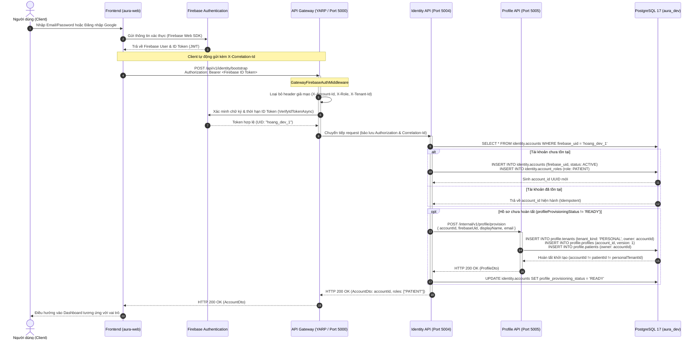
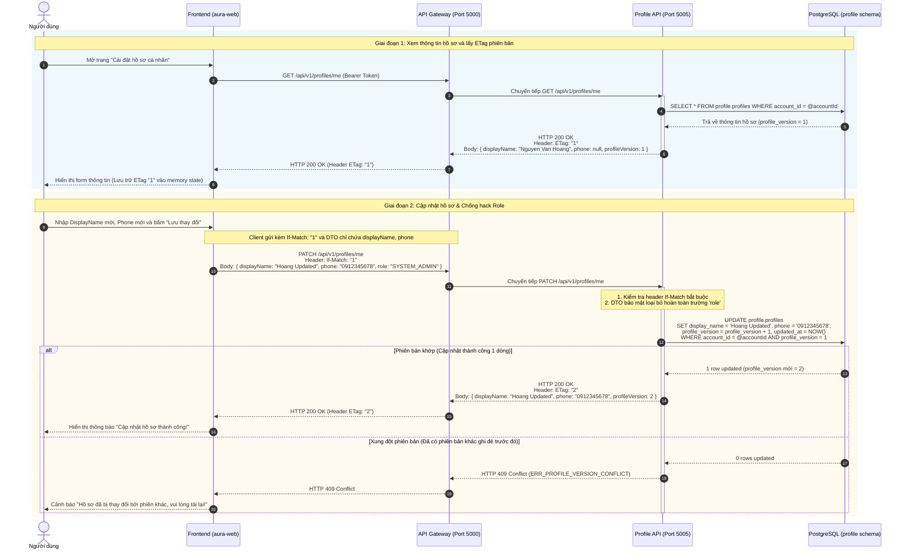
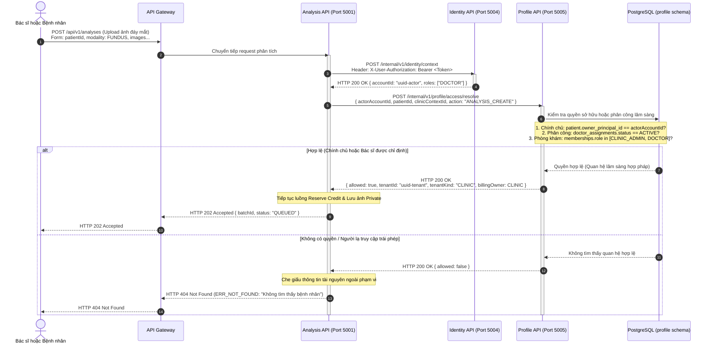

# AURA — Sơ đồ Tuần tự Tương tác (Sequence Diagrams): Identity & Profile Services

- **Mã đề tài**: SP26SE025 — Hệ thống sàng lọc sức khỏe mạch máu võng mạc (AURA)
- **Sprint**: Sprint 2
- **Task Jira**: SCRUM-316 (W2-M6-03: Kiểm thử và tài liệu Identity/Profile)
- **Module phụ trách**: M6 (Identity & Profile Services)
- **Thời điểm hoàn thành**: 2026-10-17

---

## 1. Sơ đồ 1: Luồng Đăng nhập, Xác thực và Khởi tạo Tài khoản (Login & Bootstrap Flow)

Mô tả quá trình người dùng đăng nhập qua Firebase Authentication trên giao diện Web, sau đó gọi qua API Gateway đến Identity Service để tạo hoặc đồng bộ tài khoản nội bộ (`accountId`), và tự động kích hoạt Profile Service để khởi tạo Personal Tenant và hồ sơ cá nhân.

---

## 2. Sơ đồ 2: Luồng Xem và Cập nhật Hồ sơ cá nhân với Optimistic Concurrency Control

Mô tả cơ chế kiểm soát đồng thời lạc quan (Optimistic Concurrency Control) thông qua Header `ETag` và `If-Match`, đồng thời chứng minh khả năng **chống sửa Role qua Profile API** để ngăn ngừa triệt để lỗ hổng leo thang đặc quyền (Privilege Escalation).

---

## 3. Sơ đồ 3: Luồng Phân giải Quyền truy cập giữa các Dịch vụ (Access Resolution Flow)

Mô tả cách Analysis Service xác minh quyền sở hữu hoặc quyền khám chữa bệnh của người gọi đối với bệnh nhân trước khi cho phép tạo yêu cầu phân tích ảnh hoặc xem kết quả.

