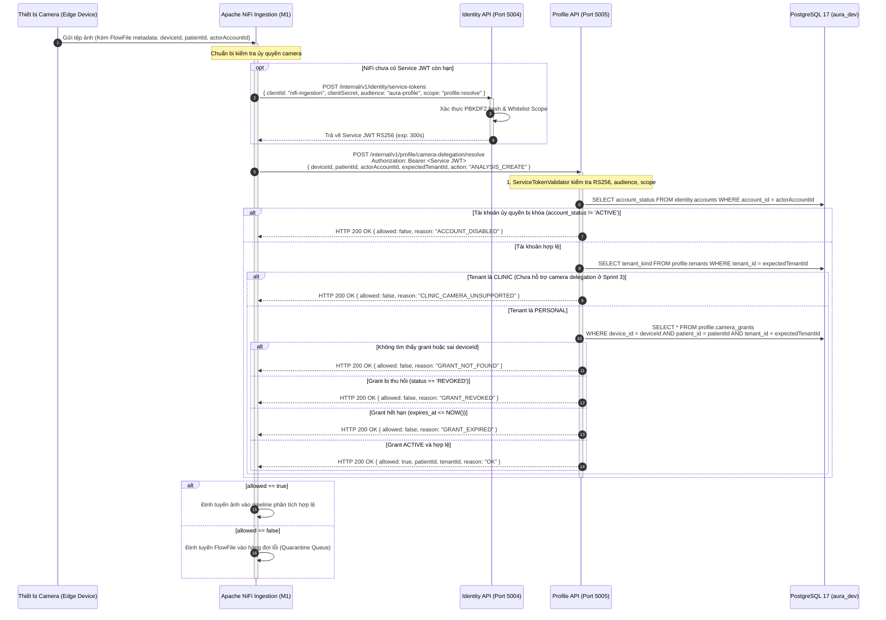
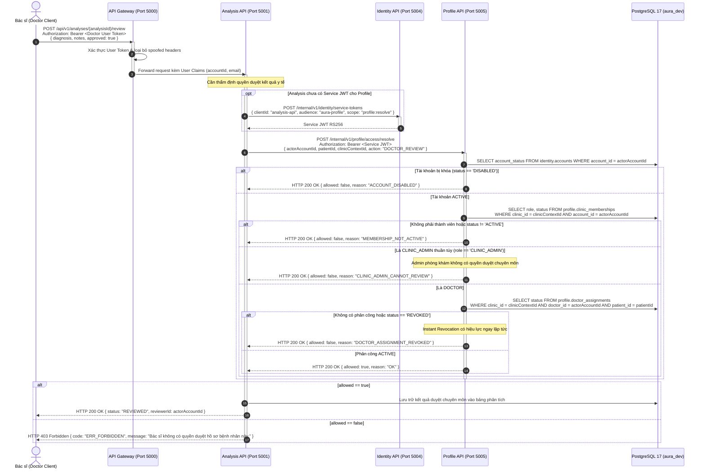
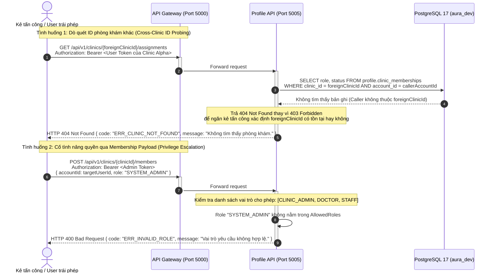

# AURA — Sơ đồ Tuần tự Phân quyền Đa Tenant (Sequence Diagrams Sprint 3)

- **Mã nhiệm vụ:** W3-M6-03 (Task Jira: SCRUM W3-M6-03)
- **Tiêu đề:** Sơ đồ Tuần tự Thẩm định Quyền Đa Tenant, Camera Delegation & Vòng đời Phân công
- **Phụ trách:** M6 (Identity & Profile Services)
- **Phiên bản:** 3.0
- **Ngày hoàn thành:** 2026-10-30

---

## 1. Sơ đồ 1: Luồng Thẩm định Ủy quyền Máy chụp (Camera Delegation Verification Flow)

Mô tả quá trình Apache NiFi (M1) nhận tệp hình ảnh từ thiết bị chụp ảnh y tế (Camera Device), gửi yêu cầu thẩm định đến Profile API (M6) qua Internal API được bảo vệ bởi Service JWT RS256 để xác thực tính hợp lệ của thiết bị, bệnh nhân và tenant trước khi lưu trữ hoặc chuyển tiếp cho phân tích.

---

## 2. Sơ đồ 2: Luồng Duyệt Kết quả Lâm sàng & Thu hồi Tức thì (Clinical Review & Instant Revocation)

Mô tả luồng Bác sĩ gửi đánh giá chuyên môn y tế (`DOCTOR_REVIEW`) trên hệ thống. Dịch vụ Analysis API (M2) gửi yêu cầu xác minh quyền đến Profile API (M6). Mọi trường hợp phân công bị thu hồi (`REVOKED`) hoặc tài khoản bị khóa (`DISABLED`) đều bị từ chối fail-closed lập tức.

---

## 3. Sơ đồ 3: Cơ chế Chống Thăm dò ID & Chống Leo quyền Đa Phòng khám (Anti-Probing & Anti-Escalation)

Mô tả cơ chế bảo vệ danh tính phòng khám khi người dùng gọi API thao tác hoặc tra cứu chéo phòng khám, hệ thống trả về mã lỗi HTTP `404 Not Found` để che giấu sự tồn tại của Clinic ID mục tiêu, đồng thời ngăn chặn nâng quyền thông qua payload.

