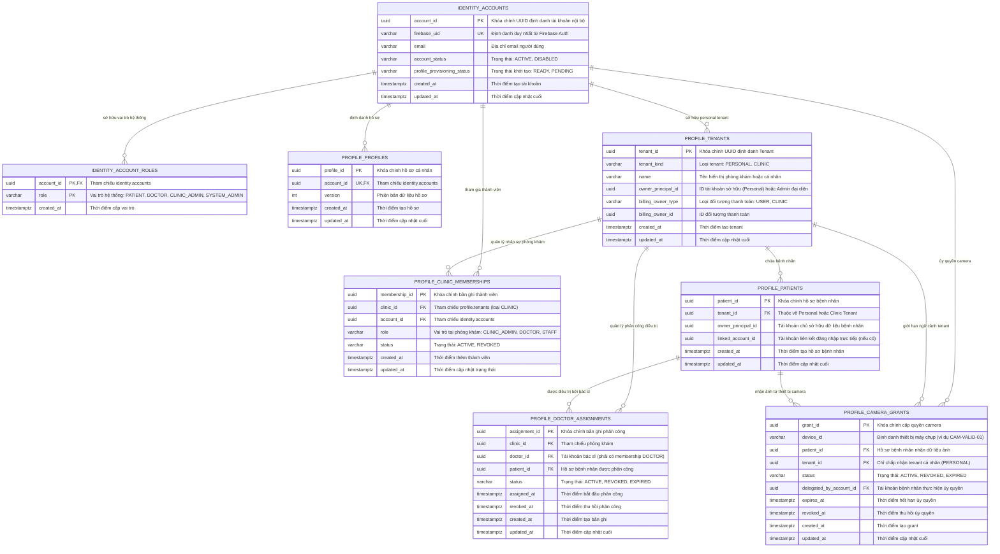

# AURA — Sơ đồ Thực thể Liên kết (ERD) & Từ điển Dữ liệu (Data Dictionary)

- **Mã nhiệm vụ:** W3-M6-03 (Task Jira: SCRUM W3-M6-03)
- **Tiêu đề:** Kiến trúc Dữ liệu Đa Tenant: Identity, Profile, Clinic, Doctor Assignments & Camera Grants
- **Phụ trách:** M6 (Identity & Profile Services)
- **Phiên bản:** 3.0 (Cập nhật hoàn thiện Sprint 3)
- **Ngày hoàn thành:** 2026-10-30

---

## 1. Tổng quan Kiến trúc Dữ liệu Đa Tenant (Multi-Tenant Architecture)

Hệ thống AURA vận hành theo mô hình kiến trúc phân tán đa người thuê (Multi-Tenant) với hai tầng bảo mật cốt lõi:
1. **Schema `identity`:** Chịu trách nhiệm xác thực danh tính người dùng (Authentication), quản lý trạng thái kích hoạt tài khoản (`account_status`: `ACTIVE`, `DISABLED`), định danh Firebase UID và các vai trò hệ thống tổng quát.
2. **Schema `profile`:** Chịu trách nhiệm quản lý ngữ cảnh tổ chức và quyền truy cập tài nguyên (Authorization):
   - Ngữ cảnh Cá nhân (`tenant_kind = 'PERSONAL'`): Mỗi bệnh nhân sở hữu một Personal Tenant riêng biệt cùng cơ chế ủy quyền thiết bị chụp (`camera_grants`).
   - Ngữ cảnh Phòng khám (`tenant_kind = 'CLINIC'`): Phòng khám đa người dùng quản lý thành viên qua `clinic_memberships` và điều phối điều trị qua `doctor_assignments`.

---

## 2. Sơ đồ Thực thể Liên kết (Entity-Relationship Diagram)

---

## 3. Từ điển Dữ liệu Chi tiết (Data Dictionary)

### 3.1. Bảng `identity.accounts`
Quản lý tài khoản đăng nhập người dùng từ Firebase Authentication.

| Cột | Kiểu dữ liệu | Nullable | Mặc định | Ràng buộc | Mô tả |
| :--- | :--- | :---: | :--- | :--- | :--- |
| `account_id` | `UUID` | NO | `gen_random_uuid()` | PK | Định danh nội bộ của tài khoản trong hệ thống. |
| `firebase_uid` | `VARCHAR(128)` | NO | Không | UNIQUE | UID duy nhất nhận được từ Firebase Authentication. |
| `email` | `VARCHAR(256)` | NO | Không | | Email liên kết với tài khoản. |
| `account_status` | `VARCHAR(32)` | NO | `'ACTIVE'` | CHECK (`'ACTIVE'`, `'DISABLED'`) | Trạng thái tài khoản. Khi `DISABLED`, hệ thống fail-closed từ chối mọi quyền. |
| `profile_provisioning_status`| `VARCHAR(32)`| NO | `'PENDING'` | CHECK (`'PENDING'`, `'READY'`) | Đánh dấu Profile API đã khởi tạo Personal Tenant thành công. |
| `created_at` | `TIMESTAMPTZ` | NO | `NOW()` | | Thời điểm tạo tài khoản. |
| `updated_at` | `TIMESTAMPTZ` | NO | `NOW()` | | Thời điểm cập nhật cuối cùng. |

*Chỉ mục:* `idx_identity_accounts_firebase_uid` (UNIQUE trên `firebase_uid`).

---

### 3.2. Bảng `identity.account_roles`
Quản lý các vai trò hệ thống cấp cao gắn với tài khoản.

| Cột | Kiểu dữ liệu | Nullable | Mặc định | Ràng buộc | Mô tả |
| :--- | :--- | :---: | :--- | :--- | :--- |
| `account_id` | `UUID` | NO | Không | PK, FK $\rightarrow$ `identity.accounts` | Tài khoản được cấp quyền. Xóa tài khoản sẽ cascade xóa vai trò. |
| `role` | `VARCHAR(32)` | NO | Không | PK | Tên vai trò: `PATIENT`, `DOCTOR`, `CLINIC_ADMIN`, `SYSTEM_ADMIN`. |
| `created_at` | `TIMESTAMPTZ` | NO | `NOW()` | | Thời điểm cấp vai trò. |

---

### 3.3. Bảng `profile.tenants`
Đại diện cho ranh giới cách ly dữ liệu: Personal (bệnh nhân) hoặc Clinic (phòng khám).

| Cột | Kiểu dữ liệu | Nullable | Mặc định | Ràng buộc | Mô tả |
| :--- | :--- | :---: | :--- | :--- | :--- |
| `tenant_id` | `UUID` | NO | `gen_random_uuid()` | PK | Định danh duy nhất của tenant. |
| `tenant_kind` | `VARCHAR(32)` | NO | Không | CHECK (`'PERSONAL'`, `'CLINIC'`) | Loại tenant xác định logic phân quyền và thanh toán. |
| `name` | `VARCHAR(255)` | NO | Không | | Tên phòng khám hoặc định danh hiển thị của cá nhân. |
| `owner_principal_id` | `UUID` | NO | Không | | Tài khoản sở hữu cá nhân hoặc đại diện phòng khám. |
| `billing_owner_type` | `VARCHAR(32)` | NO | `'USER'` | CHECK (`'USER'`, `'CLINIC'`) | Đối tượng chịu trách nhiệm thanh toán cước phí. |
| `billing_owner_id` | `UUID` | NO | Không | | ID tương ứng của User hoặc Clinic chịu thanh toán. |
| `created_at` | `TIMESTAMPTZ` | NO | `NOW()` | | Thời điểm tạo tenant. |
| `updated_at` | `TIMESTAMPTZ` | NO | `NOW()` | | Thời điểm cập nhật cuối cùng. |

*Chỉ mục & Ràng buộc:* Partial Unique Index `idx_profile_tenants_owner_personal` trên `(owner_principal_id) WHERE tenant_kind = 'PERSONAL'`.

---

### 3.4. Bảng `profile.clinic_memberships`
Quản lý danh sách nhân sự trực thuộc phòng khám (Sprint 3 — W3-M6-01).

| Cột | Kiểu dữ liệu | Nullable | Mặc định | Ràng buộc | Mô tả |
| :--- | :--- | :---: | :--- | :--- | :--- |
| `membership_id` | `UUID` | NO | `gen_random_uuid()` | PK | Định danh bản ghi thành viên. |
| `clinic_id` | `UUID` | NO | Không | FK $\rightarrow$ `profile.tenants` | Phòng khám trực thuộc (phải có `tenant_kind = 'CLINIC'`). |
| `account_id` | `UUID` | NO | Không | FK $\rightarrow$ `identity.accounts` | Tài khoản nhân sự được gán vào phòng khám. |
| `role` | `VARCHAR(32)` | NO | Không | CHECK (`'CLINIC_ADMIN'`, `'DOCTOR'`, `'STAFF'`) | Vai trò chức năng của nhân viên trong phòng khám. |
| `status` | `VARCHAR(32)` | NO | `'ACTIVE'` | CHECK (`'ACTIVE'`, `'REVOKED'`) | Trạng thái: Khi bị thu hồi (`REVOKED`), mất quyền truy cập tức thì. |
| `created_at` | `TIMESTAMPTZ` | NO | `NOW()` | | Thời điểm mời hoặc thêm vào phòng khám. |
| `updated_at` | `TIMESTAMPTZ` | NO | `NOW()` | | Thời điểm cập nhật vai trò hoặc thu hồi quyền. |

*Chỉ mục:* Unique Index trên `(clinic_id, account_id)` để đảm bảo mỗi tài khoản chỉ có 1 bản ghi thành viên trong một phòng khám.

---

### 3.5. Bảng `profile.doctor_assignments`
Quản lý quan hệ phân công điều trị giữa bác sĩ và bệnh nhân tại phòng khám (Sprint 3 — W3-M6-02).

| Cột | Kiểu dữ liệu | Nullable | Mặc định | Ràng buộc | Mô tả |
| :--- | :--- | :---: | :--- | :--- | :--- |
| `assignment_id` | `UUID` | NO | `gen_random_uuid()` | PK | Định danh duy nhất của phân công bác sĩ. |
| `clinic_id` | `UUID` | NO | Không | FK $\rightarrow$ `profile.tenants` | Phòng khám diễn ra phân công điều trị. |
| `doctor_id` | `UUID` | NO | Không | FK $\rightarrow$ `identity.accounts` | Bác sĩ được phân công (phải có membership DOCTOR tại clinic). |
| `patient_id` | `UUID` | NO | Không | FK $\rightarrow$ `profile.patients` | Hồ sơ bệnh nhân được phân công theo dõi/điều trị. |
| `status` | `VARCHAR(32)` | NO | `'ACTIVE'` | CHECK (`'ACTIVE'`, `'REVOKED'`, `'EXPIRED'`) | Trạng thái phân công: Khi `REVOKED`, bác sĩ mất quyền `DOCTOR_REVIEW` lập tức. |
| `assigned_at` | `TIMESTAMPTZ` | NO | `NOW()` | | Thời điểm bắt đầu có hiệu lực phân công. |
| `revoked_at` | `TIMESTAMPTZ` | YES | `NULL` | | Thời điểm ghi nhận thu hồi phân công. |
| `created_at` | `TIMESTAMPTZ` | NO | `NOW()` | | Thời điểm tạo bản ghi. |
| `updated_at` | `TIMESTAMPTZ` | NO | `NOW()` | | Thời điểm cập nhật cuối. |

*Chỉ mục:* `idx_doctor_assignments_active` trên `(clinic_id, doctor_id, patient_id) WHERE status = 'ACTIVE'`.

---

### 3.6. Bảng `profile.camera_grants`
Quản lý quyền ủy quyền thiết bị camera chụp ảnh tự động gửi về hồ sơ bệnh nhân (Sprint 3 — W3-M6-02).

| Cột | Kiểu dữ liệu | Nullable | Mặc định | Ràng buộc | Mô tả |
| :--- | :--- | :---: | :--- | :--- | :--- |
| `grant_id` | `UUID` | NO | `gen_random_uuid()` | PK | Định danh bản ghi ủy quyền camera. |
| `device_id` | `VARCHAR(128)` | NO | Không | | Định danh duy nhất của thiết bị chụp ảnh y tế. |
| `patient_id` | `UUID` | NO | Không | FK $\rightarrow$ `profile.patients` | Bệnh nhân thụ hưởng kết quả chụp ảnh. |
| `tenant_id` | `UUID` | NO | Không | FK $\rightarrow$ `profile.tenants` | Chỉ chấp nhận tenant cá nhân (`tenant_kind = 'PERSONAL'`). |
| `status` | `VARCHAR(32)` | NO | `'ACTIVE'` | CHECK (`'ACTIVE'`, `'REVOKED'`, `'EXPIRED'`) | Trạng thái grant camera. |
| `delegated_by_account_id` | `UUID` | NO | Không | FK $\rightarrow$ `identity.accounts` | Bệnh nhân chủ quản thực hiện thao tác ủy quyền thiết bị. |
| `expires_at` | `TIMESTAMPTZ` | NO | Không | | Thời điểm hết hạn hiệu lực ủy quyền. |
| `revoked_at` | `TIMESTAMPTZ` | YES | `NULL` | | Thời điểm thiết bị bị thu hồi quyền. |
| `created_at` | `TIMESTAMPTZ` | NO | `NOW()` | | Thời điểm tạo grant. |
| `updated_at` | `TIMESTAMPTZ` | NO | `NOW()` | | Thời điểm cập nhật cuối. |

*Chỉ mục:* `idx_camera_grants_lookup` trên `(device_id, patient_id, tenant_id, status)`.

---

## 4. Chính sách Phân quyền & Phòng vệ Dữ liệu (Security Rules)

1. **Nguyên tắc Cách ly Tenant Chặt chẽ (Tenant Isolation):**
   - Personal Tenant hoàn toàn cách ly với Clinic Tenant. Thiết bị Camera chỉ được cấp quyền cho Personal Tenant.
   - Khi truy vấn tài nguyên của phòng khám khác, hệ thống bắt buộc trả về `404 Not Found` (thay vì `403 Forbidden`) để ngăn chặn việc dò quét sự tồn tại của Clinic ID (`Anti-Probing`).
2. **Nguyên tắc Thu hồi Tức thì (Instant Revocation):**
   - Mọi thay đổi trạng thái sang `REVOKED` (Membership, Doctor Assignment hoặc Camera Grant) đều có hiệu lực ngay trong lần gọi API tiếp theo của Analysis / Gateway mà không có độ trễ bộ đệm.
3. **Cơ chế Fail-Closed khi Tài khoản Bị Khóa:**
   - Profile API kiểm tra trường `account_status` tại bảng `identity.accounts`. Nếu tài khoản có giá trị khác `ACTIVE` (ví dụ `DISABLED`), quyền truy cập lập tức bị từ chối (`Allowed: false`).
4. **Bảo vệ Tính Toàn vẹn Dữ liệu (Anti-Tampering):**
   - Các dịch vụ ngoài (Apache NiFi, Analysis API, AI Core) tuyệt đối không được cấp quyền DDL hoặc ghi trực tiếp vào các schema `identity` và `profile`. Mọi tương tác kiểm tra phân quyền phải thông qua Internal API có xác thực Service JWT RS256.
