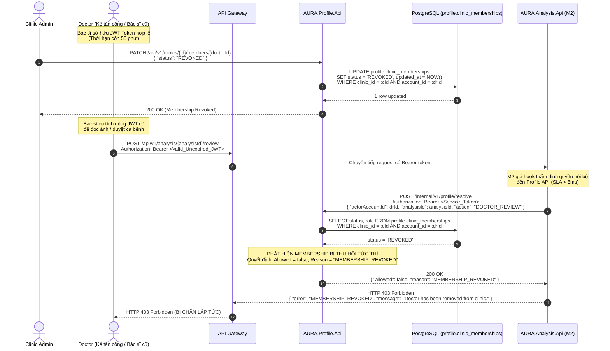

# AURA — Sơ đồ Thực thể Liên kết (ERD) & Từ điển Dữ liệu (Data Dictionary v1.2)

- **Mã nhiệm vụ:** W4-M6-04 (Task Jira: SCRUM W4-M6-04)
- **Tiêu đề:** Kiến trúc Dữ liệu Đa Tenant: Identity, Profile, Clinic Lifecycle, Patient Registry, Doctor Assignments, Screening Campaigns & Camera Grants
- **Phụ trách:** M6 (Identity & Profile Services)
- **Phiên bản:** 4.0 (Data Dictionary v1.2 - Cập nhật đồng bộ Sprint 4)
- **Ngày hoàn thành:** 2026-11-01
- **Trạng thái:** BÀN GIAO CHÍNH THỨC (DoD AC3 Hoàn tất)

---

## 1. Tổng quan Kiến trúc Dữ liệu Đa Tenant (Multi-Tenant Architecture)

Hệ thống AURA vận hành theo mô hình kiến trúc phân tán đa người thuê (Multi-Tenant) với ba tầng bảo mật và phân quyền tài nguyên:
1. **Schema `identity`:** Quản lý xác thực danh tính người dùng (Authentication), trạng thái kích hoạt tài khoản (`account_status`: `ACTIVE`, `DISABLED`), định danh Firebase UID, và phân quyền vai trò hệ thống tổng quát (`identity.account_roles`).
2. **Schema `profile`:** Quản lý ranh giới dữ liệu tổ chức (Multi-Tenant Organization Boundary) và quyền truy cập tài nguyên (Resource Authorization):
   - **Ngữ cảnh Cá nhân (`tenant_kind = 'PERSONAL'`):** Mỗi người dùng cá nhân sở hữu một Personal Tenant riêng biệt, tự quản lý hồ sơ và cấp quyền ủy quyền thiết bị chụp quỹ đạo (`camera_grants`).
   - **Ngữ cảnh Phòng khám (`tenant_kind = 'CLINIC'`):** Phòng khám y tế vận hành theo vòng đời pháp nhân (`profile.clinics`), tuyển dụng và quản lý nhân viên qua lời mời (`profile.clinic_invitations`) và thành viên (`profile.clinic_memberships`), đăng ký bệnh nhân nội bộ (`profile.patients` với `patient_type = 'CLINIC_MANAGED'`), và phân công bác sĩ phụ trách ca bệnh (`profile.doctor_assignments`).
3. **Schema `analysis`:** Quản lý quy trình phân tích AI và chiến dịch tầm soát cộng đồng:
   - **Chiến dịch tầm soát (`analysis.campaigns`):** Tổ chức đợt khám sàng lọc quy mô lớn gắn với Tenant phòng khám, quản lý tiến độ và liên kết các lô ảnh Fundus (`analysis.batches`).

---

## 2. Sơ đồ Thực thể Liên kết (Entity-Relationship Diagram - ERD)

```mermaid
erDiagram
    IDENTITY_ACCOUNTS ||--o{ IDENTITY_ACCOUNT_ROLES : "sở hữu vai trò"
    IDENTITY_ACCOUNTS ||--o{ PROFILE_PROFILES : "định danh hồ sơ cá nhân"
    IDENTITY_ACCOUNTS ||--o{ PROFILE_TENANTS : "sở hữu personal tenant"
    IDENTITY_ACCOUNTS ||--o{ PROFILE_CLINIC_MEMBERSHIPS : "tham gia thành viên clinic"
    IDENTITY_ACCOUNTS ||--o{ PROFILE_CAMERA_GRANTS : "ủy quyền camera cá nhân"
    IDENTITY_ACCOUNTS ||--o{ PROFILE_CLINIC_INVITATIONS : "được mời tham gia"

    PROFILE_CLINICS ||--|| PROFILE_TENANTS : "liên kết 1-1 với tenant loại CLINIC"
    PROFILE_CLINICS ||--o{ PROFILE_CLINIC_INVITATIONS : "phát hành lời mời nhân sự"
    PROFILE_CLINICS ||--o{ PROFILE_CLINIC_MEMBERSHIPS : "quản lý danh sách thành viên"
    PROFILE_CLINICS ||--o{ PROFILE_PATIENTS : "quản lý bệnh nhân nội bộ"
    PROFILE_CLINICS ||--o{ PROFILE_DOCTOR_ASSIGNMENTS : "điều phối phân công điều trị"
    PROFILE_CLINICS ||--o{ ANALYSIS_CAMPAIGNS : "tổ chức chiến dịch tầm soát"

    PROFILE_PATIENTS ||--o{ PROFILE_DOCTOR_ASSIGNMENTS : "được gán cho bác sĩ"
    PROFILE_PATIENTS ||--o{ PROFILE_CAMERA_GRANTS : "nhận ảnh từ camera cá nhân"

    ANALYSIS_CAMPAIGNS ||--o{ ANALYSIS_BATCHES : "chứa các lô ảnh tầm soát"

    IDENTITY_ACCOUNTS {
        uuid account_id PK "Khóa chính UUID định danh tài khoản nội bộ"
        varchar firebase_uid UK "Định danh duy nhất từ Firebase Auth"
        varchar email "Địa chỉ email người dùng"
        varchar account_status "Trạng thái: ACTIVE, DISABLED"
        varchar profile_provisioning_status "Trạng thái khởi tạo: READY, PENDING"
        timestamptz created_at "Thời điểm tạo tài khoản"
        timestamptz updated_at "Thời điểm cập nhật cuối"
    }

    IDENTITY_ACCOUNT_ROLES {
        uuid account_id PK, FK "Tham chiếu identity.accounts"
        varchar role PK "Vai trò hệ thống: PATIENT, DOCTOR, CLINIC_ADMIN, SYSTEM_ADMIN"
        timestamptz created_at "Thời điểm cấp vai trò"
    }

    PROFILE_TENANTS {
        uuid tenant_id PK "Khóa chính UUID định danh Tenant"
        varchar tenant_kind "Loại tenant: PERSONAL, CLINIC"
        varchar name "Tên hiển thị phòng khám hoặc cá nhân"
        uuid owner_principal_id "ID tài khoản sở hữu (Personal) hoặc Admin phòng khám"
        varchar billing_owner_type "Loại đối tượng thanh toán: USER, CLINIC"
        uuid billing_owner_id "ID đối tượng thanh toán"
        timestamptz created_at "Thời điểm tạo tenant"
        timestamptz updated_at "Thời điểm cập nhật cuối"
    }

    PROFILE_CLINICS {
        uuid clinic_id PK, FK "Tham chiếu profile.tenants(tenant_id)"
        varchar code UK "Mã định danh phòng khám duy nhất (ví dụ: CLN-001)"
        varchar name "Tên pháp nhân phòng khám"
        varchar tax_id "Mã số thuế doanh nghiệp y tế"
        varchar address "Địa chỉ hoạt động của phòng khám"
        varchar phone "Số điện thoại liên hệ"
        varchar license_number "Giấy phép hoạt động khám chữa bệnh"
        varchar status "Trạng thái: PENDING_APPROVAL, ACTIVE, SUSPENDED"
        uuid created_by FK "Tài khoản đăng ký ban đầu"
        uuid approved_by FK "Tài khoản SYSTEM_ADMIN phê duyệt"
        timestamptz approved_at "Thời điểm phê duyệt"
        timestamptz created_at "Thời điểm đăng ký"
        timestamptz updated_at "Thời điểm cập nhật"
    }

    PROFILE_CLINIC_INVITATIONS {
        uuid invitation_id PK "Khóa chính UUID của lời mời"
        uuid clinic_id FK "Tham chiếu profile.clinics"
        varchar email "Email nhân sự được mời"
        varchar role "Vai trò gán: CLINIC_ADMIN, DOCTOR, STAFF"
        varchar token UK "Mã bảo mật tiếp nhận lời mời (Secure Token)"
        timestamptz expires_at "Thời điểm hết hạn (mặc định 7 ngày)"
        varchar status "Trạng thái: PENDING, ACCEPTED, REVOKED, EXPIRED"
        uuid invited_by FK "Tài khoản Admin phát hành lời mời"
        timestamptz created_at "Thời điểm tạo lời mời"
        timestamptz updated_at "Thời điểm xử lý cuối"
    }

    PROFILE_CLINIC_MEMBERSHIPS {
        uuid membership_id PK "Khóa chính bản ghi thành viên"
        uuid clinic_id FK "Tham chiếu profile.clinics / profile.tenants"
        uuid account_id FK "Tham chiếu identity.accounts"
        varchar role "Vai trò tại phòng khám: CLINIC_ADMIN, DOCTOR, STAFF"
        varchar status "Trạng thái: ACTIVE, REVOKED"
        timestamptz created_at "Thời điểm thêm thành viên"
        timestamptz updated_at "Thời điểm cập nhật hoặc thu hồi"
    }

    PROFILE_PATIENTS {
        uuid patient_id PK "Khóa chính hồ sơ bệnh nhân"
        uuid tenant_id FK "Thuộc về Personal hoặc Clinic Tenant"
        varchar patient_type "Phân loại bệnh nhân: PERSONAL, CLINIC_MANAGED"
        varchar full_name "Họ và tên bệnh nhân"
        date date_of_birth "Ngày tháng năm sinh"
        varchar gender "Giới tính: MALE, FEMALE, OTHER"
        varchar phone "Số điện thoại liên hệ"
        varchar health_insurance_number "Mã số bảo hiểm y tế (BHYT)"
        jsonb medical_history "Tiền sử bệnh án (JSON cấu trúc)"
        uuid owner_principal_id "Tài khoản chủ sở hữu dữ liệu"
        uuid linked_account_id "Tài khoản liên kết đăng nhập trực tiếp (nếu có)"
        timestamptz created_at "Thời điểm tạo hồ sơ"
        timestamptz updated_at "Thời điểm cập nhật"
    }

    PROFILE_DOCTOR_ASSIGNMENTS {
        uuid assignment_id PK "Khóa chính bản ghi phân công"
        uuid clinic_id FK "Tham chiếu phòng khám"
        uuid doctor_id FK "Tài khoản bác sĩ (phải có membership DOCTOR)"
        uuid patient_id FK "Hồ sơ bệnh nhân được phân công"
        uuid analysis_id FK "Ca chụp phân tích cụ thể (nếu phân công theo ca)"
        uuid transferred_from_assignment_id FK "Phân công gốc trước khi bàn giao"
        text notes "Ghi chú phân công lâm sàng"
        varchar status "Trạng thái: ACTIVE, REVOKED, EXPIRED"
        timestamptz assigned_at "Thời điểm bắt đầu phân công"
        timestamptz revoked_at "Thời điểm thu hồi phân công"
        timestamptz created_at "Thời điểm tạo bản ghi"
        timestamptz updated_at "Thời điểm cập nhật cuối"
    }

    PROFILE_CAMERA_GRANTS {
        uuid grant_id PK "Khóa chính cấp quyền camera"
        varchar device_id "Định danh thiết bị máy chụp (ví dụ CAM-VALID-01)"
        uuid patient_id FK "Hồ sơ bệnh nhân nhận dữ liệu ảnh"
        uuid tenant_id FK "Chỉ chấp nhận tenant cá nhân (PERSONAL)"
        varchar status "Trạng thái: ACTIVE, REVOKED, EXPIRED"
        uuid delegated_by_account_id FK "Tài khoản bệnh nhân thực hiện ủy quyền"
        timestamptz expires_at "Thời điểm hết hạn ủy quyền"
        timestamptz revoked_at "Thời điểm thu hồi ủy quyền"
        timestamptz created_at "Thời điểm tạo grant"
        timestamptz updated_at "Thời điểm cập nhật cuối"
    }

    ANALYSIS_CAMPAIGNS {
        uuid id PK "Khóa chính UUID chiến dịch tầm soát"
        uuid tenant_id FK "Tham chiếu Clinic Tenant tổ chức"
        varchar name "Tên chiến dịch tầm soát"
        text description "Mục tiêu và phạm vi tầm soát"
        varchar location "Địa điểm triển khai khám cộng đồng"
        uuid doctor_in_charge_id FK "Bác sĩ trưởng phụ trách chuyên môn"
        int target_patient_count "Số lượng bệnh nhân mục tiêu"
        varchar status "Trạng thái: PLANNED, IN_PROGRESS, COMPLETED, CLOSED"
        timestamptz start_date "Thời gian bắt đầu đợt khám"
        timestamptz end_date "Thời gian kết thúc đợt khám"
        timestamptz created_at "Thời điểm tạo chiến dịch"
        timestamptz updated_at "Thời điểm cập nhật"
    }

    ANALYSIS_BATCHES {
        uuid id PK "Khóa chính lô ảnh chụp Fundus"
        uuid tenant_id FK "Tenant phòng khám sở hữu lô ảnh"
        uuid campaign_id FK "Liên kết vào chiến dịch tầm soát (Analysis 006)"
        varchar name "Tên lô ảnh tiếp nhận"
        varchar status "Trạng thái xử lý lô: COMPLETED, PROCESSING..."
        timestamptz created_at "Thời điểm tạo lô ảnh"
    }
```

---

## 3. Từ điển Dữ liệu Chi tiết (Data Dictionary v1.2)

### 3.1. Bảng `identity.accounts`
Quản lý tài khoản đăng nhập người dùng từ Firebase Authentication.

| Cột | Kiểu dữ liệu | Nullable | Mặc định | Ràng buộc | Mô tả |
| :--- | :--- | :---: | :--- | :--- | :--- |
| `account_id` | `UUID` | NO | `gen_random_uuid()` | PK | Định danh nội bộ của tài khoản trong hệ thống AURA. |
| `firebase_uid` | `VARCHAR(128)` | NO | Không | UNIQUE | UID duy nhất nhận được từ Firebase Authentication. |
| `email` | `VARCHAR(256)` | NO | Không | | Email liên kết với tài khoản. |
| `account_status` | `VARCHAR(32)` | NO | `'ACTIVE'` | CHECK (`'ACTIVE'`, `'DISABLED'`) | Trạng thái tài khoản. Khi `DISABLED`, hệ thống fail-closed từ chối mọi quyền truy cập ngay lập tức. |
| `profile_provisioning_status`| `VARCHAR(32)`| NO | `'PENDING'` | CHECK (`'PENDING'`, `'READY'`) | Đánh dấu Profile API đã khởi tạo Personal Tenant thành công. |
| `created_at` | `TIMESTAMPTZ` | NO | `NOW()` | | Thời điểm tạo tài khoản. |
| `updated_at` | `TIMESTAMPTZ` | NO | `NOW()` | | Thời điểm cập nhật cuối cùng. |

*Chỉ mục:* `idx_identity_accounts_firebase_uid` (UNIQUE trên `firebase_uid`).

---

### 3.2. Bảng `identity.account_roles`
Quản lý các vai trò hệ thống cấp cao gắn với tài khoản.

| Cột | Kiểu dữ liệu | Nullable | Mặc định | Ràng buộc | Mô tả |
| :--- | :--- | :---: | :--- | :--- | :--- |
| `account_id` | `UUID` | NO | Không | PK, FK $\rightarrow$ `identity.accounts` | Tài khoản được cấp quyền. Xóa tài khoản cascade xóa vai trò. |
| `role` | `VARCHAR(32)` | NO | Không | PK | Tên vai trò: `PATIENT`, `DOCTOR`, `CLINIC_ADMIN`, `SYSTEM_ADMIN`. |
| `created_at` | `TIMESTAMPTZ` | NO | `NOW()` | | Thời điểm cấp vai trò. |

---

### 3.3. Bảng `profile.tenants`
Đại diện cho ranh giới cách ly dữ liệu: Personal (bệnh nhân) hoặc Clinic (phòng khám).

| Cột | Kiểu dữ liệu | Nullable | Mặc định | Ràng buộc | Mô tả |
| :--- | :--- | :---: | :--- | :--- | :--- |
| `tenant_id` | `UUID` | NO | `gen_random_uuid()` | PK | Định danh duy nhất của tenant. |
| `tenant_kind` | `VARCHAR(32)` | NO | Không | CHECK (`'PERSONAL'`, `'CLINIC'`) | Loại tenant xác định logic phân quyền và thanh toán. |
| `name` | `VARCHAR(255)` | NO | Không | | Tên phòng khám hoặc định danh hiển thị của cá nhân. |
| `owner_principal_id` | `UUID` | NO | Không | | Tài khoản sở hữu cá nhân hoặc đại diện phòng khám. |
| `billing_owner_type` | `VARCHAR(32)` | NO | `'USER'` | CHECK (`'USER'`, `'CLINIC'`) | Đối tượng chịu trách nhiệm thanh toán cước phí. |
| `billing_owner_id` | `UUID` | NO | Không | | ID tương ứng của User hoặc Clinic chịu thanh toán. |
| `created_at` | `TIMESTAMPTZ` | NO | `NOW()` | | Thời điểm tạo tenant. |
| `updated_at` | `TIMESTAMPTZ` | NO | `NOW()` | | Thời điểm cập nhật cuối cùng. |

---

### 3.4. Bảng `profile.clinics` (Migration 010 — Mới trong Sprint 4)
Quản lý hồ sơ pháp nhân, trạng thái kiểm duyệt và vòng đời hoạt động của phòng khám y tế.

| Cột | Kiểu dữ liệu | Nullable | Mặc định | Ràng buộc | Mô tả |
| :--- | :--- | :---: | :--- | :--- | :--- |
| `clinic_id` | `UUID` | NO | Không | PK, FK $\rightarrow$ `profile.tenants(tenant_id)` | Khóa chính tham chiếu trực tiếp đến tenant loại `CLINIC`. |
| `code` | `VARCHAR(32)` | NO | Không | UNIQUE | Mã phòng khám ngắn gọn duy nhất (ví dụ: `CLN-001`, `AURA-SG`). |
| `name` | `VARCHAR(255)` | NO | Không | | Tên pháp lý chính thức của cơ sở y tế / phòng khám. |
| `tax_id` | `VARCHAR(64)` | YES | `NULL` | | Mã số thuế của doanh nghiệp y tế. |
| `address` | `TEXT` | YES | `NULL` | | Địa chỉ trụ sở hoạt động của phòng khám. |
| `phone` | `VARCHAR(32)` | YES | `NULL` | | Số điện thoại liên hệ tổng đài phòng khám. |
| `license_number` | `VARCHAR(128)`| YES | `NULL` | | Giấy phép hoạt động khám chữa bệnh được Sở Y tế cấp. |
| `status` | `VARCHAR(32)` | NO | `'PENDING_APPROVAL'` | CHECK (`'PENDING_APPROVAL'`, `'ACTIVE'`, `'SUSPENDED'`) | Trạng thái phòng khám: Khi `SUSPENDED`, toàn bộ bác sĩ/nhân viên lập tức mất quyền hoạt động. |
| `created_by` | `UUID` | NO | Không | FK $\rightarrow$ `identity.accounts` | Tài khoản người đại diện đăng ký thành lập phòng khám. |
| `approved_by` | `UUID` | YES | `NULL` | FK $\rightarrow$ `identity.accounts` | Tài khoản System Admin thực hiện phê duyệt phòng khám. |
| `approved_at` | `TIMESTAMPTZ` | YES | `NULL` | | Thời điểm System Admin phê duyệt kích hoạt phòng khám. |
| `created_at` | `TIMESTAMPTZ` | NO | `NOW()` | | Thời điểm nộp đơn đăng ký phòng khám. |
| `updated_at` | `TIMESTAMPTZ` | NO | `NOW()` | | Thời điểm cập nhật trạng thái/thông tin cuối cùng. |

---

### 3.5. Bảng `profile.clinic_invitations` (Migration 010 — Mới trong Sprint 4)
Quản lý quy trình mời nhân sự (bác sĩ, kỹ thuật viên, quản trị viên) tham gia vào phòng khám qua token bảo mật.

| Cột | Kiểu dữ liệu | Nullable | Mặc định | Ràng buộc | Mô tả |
| :--- | :--- | :---: | :--- | :--- | :--- |
| `invitation_id` | `UUID` | NO | `gen_random_uuid()` | PK | Định danh bản ghi lời mời. |
| `clinic_id` | `UUID` | NO | Không | FK $\rightarrow$ `profile.clinics` | Phòng khám phát hành lời mời. |
| `email` | `VARCHAR(256)` | NO | Không | | Địa chỉ email nhân sự được mời nhận lời. |
| `role` | `VARCHAR(32)` | NO | Không | CHECK (`'CLINIC_ADMIN'`, `'DOCTOR'`, `'STAFF'`) | Vai trò dự kiến gán khi người dùng chấp nhận lời mời. |
| `token` | `VARCHAR(128)` | NO | Không | UNIQUE | Token bảo mật ngẫu nhiên mã hóa gửi qua email mời. |
| `expires_at` | `TIMESTAMPTZ` | NO | Không | | Thời điểm hết hạn hiệu lực của lời mời (mặc định 7 ngày). |
| `status` | `VARCHAR(32)` | NO | `'PENDING'` | CHECK (`'PENDING'`, `'ACCEPTED'`, `'REVOKED'`, `'EXPIRED'`) | Trạng thái lời mời: Khi `EXPIRED` hoặc `REVOKED`, token vô hiệu lực. |
| `invited_by` | `UUID` | NO | Không | FK $\rightarrow$ `identity.accounts` | Tài khoản Quản trị viên phòng khám gửi lời mời. |
| `created_at` | `TIMESTAMPTZ` | NO | `NOW()` | | Thời điểm phát hành lời mời. |
| `updated_at` | `TIMESTAMPTZ` | NO | `NOW()` | | Thời điểm cập nhật trạng thái cuối cùng. |

---

### 3.6. Bảng `profile.clinic_memberships`
Quản lý quan hệ nhân sự trực thuộc phòng khám và trạng thái hiệu lực tức thì.

| Cột | Kiểu dữ liệu | Nullable | Mặc định | Ràng buộc | Mô tả |
| :--- | :--- | :---: | :--- | :--- | :--- |
| `membership_id` | `UUID` | NO | `gen_random_uuid()` | PK | Định danh bản ghi thành viên phòng khám. |
| `clinic_id` | `UUID` | NO | Không | FK $\rightarrow$ `profile.clinics` | Phòng khám trực thuộc (`profile.tenants` loại `CLINIC`). |
| `account_id` | `UUID` | NO | Không | FK $\rightarrow$ `identity.accounts` | Tài khoản nhân sự được gán vào phòng khám. |
| `role` | `VARCHAR(32)` | NO | Không | CHECK (`'CLINIC_ADMIN'`, `'DOCTOR'`, `'STAFF'`) | Vai trò chức năng trong phòng khám. |
| `status` | `VARCHAR(32)` | NO | `'ACTIVE'` | CHECK (`'ACTIVE'`, `'REVOKED'`) | Trạng thái: Khi bị thu hồi (`REVOKED`), mất toàn bộ quyền truy cập tức thì mà không cần chờ JWT hết hạn. |
| `created_at` | `TIMESTAMPTZ` | NO | `NOW()` | | Thời điểm thêm thành viên vào phòng khám. |
| `updated_at` | `TIMESTAMPTZ` | NO | `NOW()` | | Thời điểm cập nhật vai trò hoặc thu hồi quyền. |

*Chỉ mục:* Unique Index trên `(clinic_id, account_id)`.

---

### 3.7. Bảng `profile.patients` (Migration 011 — Cập nhật mở rộng Sprint 4)
Quản lý hồ sơ bệnh nhân, hỗ trợ phân loại cá nhân tự do (`PERSONAL`) và bệnh nhân được quản lý nội bộ bởi phòng khám (`CLINIC_MANAGED`).

| Cột | Kiểu dữ liệu | Nullable | Mặc định | Ràng buộc | Mô tả |
| :--- | :--- | :---: | :--- | :--- | :--- |
| `patient_id` | `UUID` | NO | `gen_random_uuid()` | PK | Khóa chính định danh hồ sơ bệnh nhân. |
| `tenant_id` | `UUID` | NO | Không | FK $\rightarrow$ `profile.tenants` | Tenant sở hữu hồ sơ (Personal Tenant hoặc Clinic Tenant). |
| `patient_type` | `VARCHAR(32)` | NO | `'PERSONAL'` | CHECK (`'PERSONAL'`, `'CLINIC_MANAGED'`) | **Sprint 4:** Phân loại bệnh nhân độc lập hay do phòng khám tạo và quản lý nội bộ. |
| `full_name` | `VARCHAR(255)` | YES | `NULL` | | **Sprint 4:** Họ và tên đầy đủ của bệnh nhân. |
| `date_of_birth` | `DATE` | YES | `NULL` | | **Sprint 4:** Ngày tháng năm sinh của bệnh nhân. |
| `gender` | `VARCHAR(16)` | YES | `NULL` | CHECK (`'MALE'`, `'FEMALE'`, `'OTHER'`) | **Sprint 4:** Giới tính bệnh nhân. |
| `phone` | `VARCHAR(32)` | YES | `NULL` | | **Sprint 4:** Số điện thoại liên hệ của bệnh nhân. |
| `health_insurance_number`| `VARCHAR(64)` | YES | `NULL` | | **Sprint 4:** Mã số Bảo hiểm Y tế (BHYT) của bệnh nhân. |
| `medical_history` | `JSONB` | YES | `'{}'` | | **Sprint 4:** Tiền sử bệnh án (bệnh tiểu đường, tăng huyết áp, tiền sử gia đình, dị ứng...). |
| `owner_principal_id` | `UUID` | YES | `NULL` | | Tài khoản sở hữu dữ liệu bệnh nhân (chính chủ hoặc Clinic Admin). |
| `linked_account_id` | `UUID` | YES | `NULL` | | Tài khoản người dùng liên kết nếu bệnh nhân tự tạo account tra cứu. |
| `created_at` | `TIMESTAMPTZ` | NO | `NOW()` | | Thời điểm đăng ký hồ sơ bệnh nhân. |
| `updated_at` | `TIMESTAMPTZ` | NO | `NOW()` | | Thời điểm cập nhật hồ sơ bệnh nhân. |

*Chỉ mục:* `idx_profile_patients_clinic_type` trên `(tenant_id, patient_type)`.

---

### 3.8. Bảng `profile.doctor_assignments` (Migration 011 — Cập nhật mở rộng Sprint 4)
Quản lý quan hệ phân công điều trị giữa Bác sĩ và Bệnh nhân / Ca chụp cụ thể, hỗ trợ chuyển giao ca bệnh (Transfer).

| Cột | Kiểu dữ liệu | Nullable | Mặc định | Ràng buộc | Mô tả |
| :--- | :--- | :---: | :--- | :--- | :--- |
| `assignment_id` | `UUID` | NO | `gen_random_uuid()` | PK | Định danh bản ghi phân công bác sĩ. |
| `clinic_id` | `UUID` | NO | Không | FK $\rightarrow$ `profile.clinics` | Phòng khám diễn ra phân công điều trị. |
| `doctor_id` | `UUID` | NO | Không | FK $\rightarrow$ `identity.accounts` | Bác sĩ được chỉ định (bắt buộc có membership `DOCTOR` đang `ACTIVE`). |
| `patient_id` | `UUID` | NO | Không | FK $\rightarrow$ `profile.patients` | Hồ sơ bệnh nhân được phân công theo dõi/điều trị. |
| `analysis_id` | `UUID` | YES | `NULL` | | **Sprint 4:** Phân công theo một ca chụp cụ thể (cho phép kiểm tra quyền chi tiết theo từng ca phân tích). |
| `transferred_from_assignment_id`| `UUID` | YES | `NULL` | FK $\rightarrow$ `doctor_assignments` | **Sprint 4:** Tham chiếu bản ghi phân công của bác sĩ cũ trước khi chuyển giao. |
| `notes` | `TEXT` | YES | `NULL` | | **Sprint 4:** Ghi chú lâm sàng hoặc lý do chuyển giao ca bệnh. |
| `status` | `VARCHAR(32)` | NO | `'ACTIVE'` | CHECK (`'ACTIVE'`, `'REVOKED'`, `'EXPIRED'`) | Trạng thái phân công: Khi `REVOKED`, bác sĩ mất quyền `DOCTOR_REVIEW` ca bệnh tức thì. |
| `assigned_at` | `TIMESTAMPTZ` | NO | `NOW()` | | Thời điểm bắt đầu có hiệu lực phân công. |
| `revoked_at` | `TIMESTAMPTZ` | YES | `NULL` | | Thời điểm ghi nhận thu hồi phân công. |
| `created_at` | `TIMESTAMPTZ` | NO | `NOW()` | | Thời điểm tạo bản ghi. |
| `updated_at` | `TIMESTAMPTZ` | NO | `NOW()` | | Thời điểm cập nhật cuối cùng. |

*Chỉ mục:* `idx_doctor_assignments_active` trên `(clinic_id, doctor_id, patient_id) WHERE status = 'ACTIVE'`; `idx_doctor_assignments_analysis` trên `(analysis_id) WHERE analysis_id IS NOT NULL`.

---

### 3.9. Bảng `profile.camera_grants`
Quản lý quyền ủy quyền thiết bị camera chụp ảnh tự động gửi về hồ sơ bệnh nhân cá nhân (Sprint 3 — W3-M6-02).

| Cột | Kiểu dữ liệu | Nullable | Mặc định | Ràng buộc | Mô tả |
| :--- | :--- | :---: | :--- | :--- | :--- |
| `grant_id` | `UUID` | NO | `gen_random_uuid()` | PK | Định danh bản ghi ủy quyền camera. |
| `device_id` | `VARCHAR(128)` | NO | Không | | Định danh duy nhất của thiết bị chụp ảnh y tế (ví dụ: `CAM-VALID-01`). |
| `patient_id` | `UUID` | NO | Không | FK $\rightarrow$ `profile.patients` | Bệnh nhân thụ hưởng kết quả chụp ảnh. |
| `tenant_id` | `UUID` | NO | Không | FK $\rightarrow$ `profile.tenants` | Chỉ chấp nhận tenant cá nhân (`tenant_kind = 'PERSONAL'`). |
| `status` | `VARCHAR(32)` | NO | `'ACTIVE'` | CHECK (`'ACTIVE'`, `'REVOKED'`, `'EXPIRED'`) | Trạng thái grant camera. |
| `delegated_by_account_id` | `UUID` | NO | Không | FK $\rightarrow$ `identity.accounts` | Bệnh nhân chủ quản thực hiện thao tác ủy quyền thiết bị. |
| `expires_at` | `TIMESTAMPTZ` | NO | Không | | Thời điểm hết hạn hiệu lực ủy quyền. |
| `revoked_at` | `TIMESTAMPTZ` | YES | `NULL` | | Thời điểm thiết bị bị thu hồi quyền. |
| `created_at` | `TIMESTAMPTZ` | NO | `NOW()` | | Thời điểm tạo grant. |
| `updated_at` | `TIMESTAMPTZ` | NO | `NOW()` | | Thời điểm cập nhật cuối cùng. |

---

### 3.10. Bảng `analysis.campaigns` (Migration 006 — Mới trong Sprint 4)
Quản lý các đợt khám sàng lọc tầm soát bệnh võng mạc tiểu đường cộng đồng hoặc khám doanh nghiệp.

| Cột | Kiểu dữ liệu | Nullable | Mặc định | Ràng buộc | Mô tả |
| :--- | :--- | :---: | :--- | :--- | :--- |
| `id` | `UUID` | NO | `gen_random_uuid()` | PK | Khóa chính UUID của chiến dịch tầm soát. |
| `tenant_id` | `UUID` | NO | Không | | Tenant phòng khám chủ trì chiến dịch tầm soát. |
| `name` | `VARCHAR(255)` | NO | Không | | Tên chiến dịch tầm soát (ví dụ: "Tầm soát ĐTĐ Quận 1 - 2026"). |
| `description` | `TEXT` | YES | `NULL` | | Mô tả mục tiêu, đối tượng tầm soát. |
| `location` | `VARCHAR(255)` | YES | `NULL` | | Địa điểm triển khai chiến dịch. |
| `doctor_in_charge_id` | `UUID` | YES | `NULL` | | Bác sĩ trưởng phụ trách chuyên môn của chiến dịch. |
| `target_patient_count` | `INT` | NO | `0` | CHECK (`>= 0`) | Số lượng bệnh nhân dự kiến tầm soát. |
| `status` | `VARCHAR(32)` | NO | `'PLANNED'` | CHECK (`'PLANNED'`, `'IN_PROGRESS'`, `'COMPLETED'`, `'CLOSED'`) | Trạng thái chiến dịch. Khi `CLOSED`, nghiêm cấm nạp thêm ảnh mới. |
| `start_date` | `TIMESTAMPTZ` | YES | `NULL` | | Thời gian bắt đầu đợt khám. |
| `end_date` | `TIMESTAMPTZ` | YES | `NULL` | | Thời gian kết thúc đợt khám. |
| `created_at` | `TIMESTAMPTZ` | NO | `NOW()` | | Thời điểm tạo chiến dịch. |
| `updated_at` | `TIMESTAMPTZ` | NO | `NOW()` | | Thời điểm cập nhật cuối cùng. |

---

### 3.11. Bảng `analysis.batches` (Migration 006 — Mở rộng liên kết Campaign)
Quản lý các lô ảnh chụp Fundus tiếp nhận từ các buổi khám.

| Cột | Kiểu dữ liệu | Nullable | Mặc định | Ràng buộc | Mô tả |
| :--- | :--- | :---: | :--- | :--- | :--- |
| `id` | `UUID` | NO | `gen_random_uuid()` | PK | Khóa chính lô ảnh. |
| `tenant_id` | `UUID` | NO | Không | | Tenant phòng khám sở hữu lô ảnh. |
| `campaign_id` | `UUID` | YES | `NULL` | FK $\rightarrow$ `analysis.campaigns(id)` | **Sprint 4:** Liên kết lô ảnh vào một Chiến dịch Tầm soát cụ thể. |
| `name` | `VARCHAR(255)` | NO | Không | | Tên gọi lô ảnh tiếp nhận. |
| `status` | `VARCHAR(32)` | NO | `'PROCESSING'` | | Trạng thái xử lý lô ảnh. |
| `created_at` | `TIMESTAMPTZ` | NO | `NOW()` | | Thời điểm tạo lô ảnh. |

---

## 4. Ma trận Phân quyền RBAC v1.2 (Role-Based Access Control Matrix)

Bảng ma trận xác định quyền hạn chi tiết giữa 5 nhóm vai trò người dùng trong hệ thống AURA:
- **`SYSTEM_ADMIN` (SA):** Quản trị viên cấp cao của nền tảng AURA.
- **`CLINIC_ADMIN` (CA):** Quản trị viên của phòng khám cụ thể.
- **`DOCTOR` (DR):** Bác sĩ lâm sàng thuộc phòng khám.
- **`STAFF` / `TECHNICIAN` (TC):** Kỹ thuật viên / Điều phối viên phòng khám.
- **`PATIENT` (PT):** Người dùng / Bệnh nhân cá nhân.

| Nhóm Tài nguyên & Endpoint | Thao tác / Hành động | SA | CA | DR | TC | PT | Quy tắc Bảo mật Đa Tenant |
| :--- | :--- | :---: | :---: | :---: | :---: | :---: | :--- |
| **Phòng khám (Clinics)** | | | | | | | |
| `POST /api/v1/clinics` | Đăng ký phòng khám mới | ❌ | ✅ | ❌ | ❌ | ❌ | Tạo clinic với trạng thái `PENDING_APPROVAL`. |
| `GET /api/v1/clinics` | Xem danh sách phòng khám | ✅ | Scope | Scope | Scope | ❌ | SA xem tất cả; các vai trò khác chỉ xem clinic mình tham gia. |
| `GET /api/v1/clinics/{id}` | Xem chi tiết phòng khám | ✅ | Scope | Scope | Scope | ❌ | Trả về `404 Not Found` nếu gọi chéo sang clinic khác (`Anti-probing`). |
| `PATCH /api/v1/clinics/{id}/status`| Duyệt / Đình chỉ phòng khám | ✅ | ❌ | ❌ | ❌ | ❌ | Chỉ duy nhất System Admin được kích hoạt hoặc đình chỉ phòng khám. |
| **Lời mời Nhân sự (Invitations)** | | | | | | | |
| `POST /api/v1/clinics/{id}/invitations` | Gửi lời mời nhân sự | ❌ | ✅ | ❌ | ❌ | ❌ | Chỉ CA của clinic mới được mời nhân sự vào phòng khám của mình. |
| `POST /api/v1/clinics/invitations/accept`| Chấp nhận lời mời qua token | ❌ | ✅ | ✅ | ✅ | ❌ | Token phải còn hạn (`expires_at > NOW`) và trạng thái `PENDING`. |
| **Bệnh nhân Nội bộ (Clinic Patients)** | | | | | | | |
| `POST /api/v1/clinics/{id}/patients` | Đăng ký bệnh nhân phòng khám | ❌ | ✅ | ✅ | ✅ | ❌ | Tự động gán `patient_type = 'CLINIC_MANAGED'` dưới clinic tenant. |
| `GET /api/v1/clinics/{id}/patients` | Danh sách bệnh nhân nội bộ | ❌ | ✅ | ✅ | ✅ | ❌ | Cố tình sửa `clinicId` khác trên URL bị chặn với `403 Forbidden`. |
| `GET /api/v1/clinics/{id}/patients/{pId}`| Xem chi tiết hồ sơ bệnh nhân | ❌ | ✅ | Scope | ❌ | ❌ | DR chỉ xem được bệnh nhân mình được phân công; sai tenant trả về `404`. |
| `PATCH /api/v1/clinics/{id}/patients/{pId}`| Cập nhật hồ sơ bệnh nhân | ❌ | ✅ | ✅ | ❌ | ❌ | Cập nhật thông tin y khoa nội bộ; tuyệt đối không đổi `patient_type`. |
| **Phân công Bác sĩ (Assignments)** | | | | | | | |
| `POST /api/v1/clinics/{id}/assignments/batch`| Gán nhóm bệnh nhân cho Bác sĩ | ❌ | ✅ | ❌ | ❌ | ❌ | Kiểm tra chặt: toàn bộ bệnh nhân và bác sĩ phải thuộc clinic. |
| `POST /api/v1/clinics/{id}/assignments/{aId}/transfer`| Bàn giao ca bệnh sang Bác sĩ khác | ❌ | ✅ | ✅ | ❌ | ❌ | Bác sĩ cũ bị thu hồi tức thì, bác sĩ mới nhận quyền duyệt ngay. |
| **Chiến dịch Tầm soát (Campaigns)** | | | | | | | |
| `POST /api/v1/campaigns` | Khởi tạo chiến dịch tầm soát | ❌ | ✅ | ✅ | ✅ | ❌ | Gắn chặt với `tenant_id` của clinic tạo chiến dịch. |
| `GET /api/v1/campaigns/{id}` | Xem tiến độ & thống kê | ❌ | ✅ | ✅ | ✅ | ❌ | Chặn xem chéo chiến dịch của phòng khám khác (`403/404`). |
| `POST /api/v1/campaigns/{id}/batches` | Gắn batch ảnh vào chiến dịch | ❌ | ✅ | ✅ | ✅ | ❌ | Từ chối nạp thêm ảnh vào chiến dịch đã `CLOSED` (`400 Bad Request`). |
| `GET /api/v1/campaigns/{id}/export` | Kết xuất báo cáo y tế CSV | ❌ | ✅ | ✅ | ❌ | ❌ | Chỉ CA và Bác sĩ phụ trách mới được kết xuất dữ liệu lâm sàng. |
| **Duyệt Hồ sơ Lâm sàng (Doctor Review)**| | | | | | | |
| `POST /api/v1/analysis/{id}/review` | Duyệt / Chỉnh sửa kết luận AI | ❌ | ❌ | ✅ | ❌ | ❌ | Chỉ Bác sĩ có assignment `ACTIVE` cho ca bệnh mới được duyệt. CA bị chặn. |
| **Ủy quyền Thiết bị (Camera Grants)** | | | | | | | |
| `POST /api/v1/camera/grants` | Ủy quyền máy chụp tự động | ❌ | ❌ | ❌ | ❌ | ✅ | Dành riêng cho Personal Tenant; Clinic Tenant bị từ chối. |
| **Internal Phân giải Quyền (M2 Hook)** | | | | | | | |
| `POST /internal/v1/profile/resolve` | Thẩm định quyền truy cập ca bệnh | Service | Service | Service | Service | Service | Service Token RS256; kiểm tra live DB state trong < 5ms. |

---

## 5. Sơ đồ Tuần tự: Thu hồi Quyền Tức thì (Revocation Immediacy Sequence Diagram)

Sơ đồ dưới đây minh họa việc thực thi điều kiện nghiệm thu **AC2**: Khi Bác sĩ bị gỡ khỏi phòng khám hoặc ca bệnh bị chuyển giao, quyền truy cập lập tức bị tước bỏ mà **không cần chờ JWT token hết hạn**.

---

## 6. Chính sách Bảo mật Đa Tenant Cốt lõi (Core Multi-Tenancy Principles)

1. **Nguyên tắc Cách ly Tenant Tuyệt đối (Absolute Tenant Isolation):**
   - Mọi truy vấn dữ liệu bệnh nhân, phân công bác sĩ, chiến dịch tầm soát bắt buộc phải có điều kiện ràng buộc `tenant_id` hoặc `clinic_id` trong câu lệnh SQL. Không bao giờ tin tưởng client-side filtering.
2. **Nguyên tắc Chống Thăm dò (Anti-Probing Defense):**
   - Khi người dùng của Clinic A cố tình tra cứu ID thuộc về Clinic B (ví dụ: `GET /api/v1/clinics/{clinicA}/patients/{patientOfClinicB}`), hệ thống bắt buộc trả về **`404 Not Found`** thay vì `403 Forbidden` để che giấu sự tồn tại của ID đó, ngăn chặn kỹ thuật duyệt ID tuần tự (Horizontal ID enumeration).
3. **Nguyên tắc Kiểm tra Quyền Thời gian thực (Zero Stale Permission Lag):**
   - Không dựa hoàn toàn vào Claims tĩnh trong JWT Token của người dùng đối với các quyền truy cập tài nguyên nhạy cảm y khoa (bệnh án, kết luận AI). Tầng nghiệp vụ luôn kiểm tra trực tiếp trạng thái Membership và Phân công trong cơ sở dữ liệu thời gian thực (`POST /internal/v1/profile/resolve` với SLA < 5ms).
4. **Nguyên tắc Khóa Phòng khám Đột xuất (Clinic Suspension Kill-Switch):**
   - Khi một phòng khám vi phạm quy chế hoặc bị Sở Y tế tạm ngưng hoạt động (`profile.clinics.status = 'SUSPENDED'`), toàn bộ các API giao dịch, nạp ảnh, duyệt ca bệnh của tất cả nhân sự thuộc phòng khám đó lập tức bị chặn đứng (`403 Forbidden`) trong 0ms.
