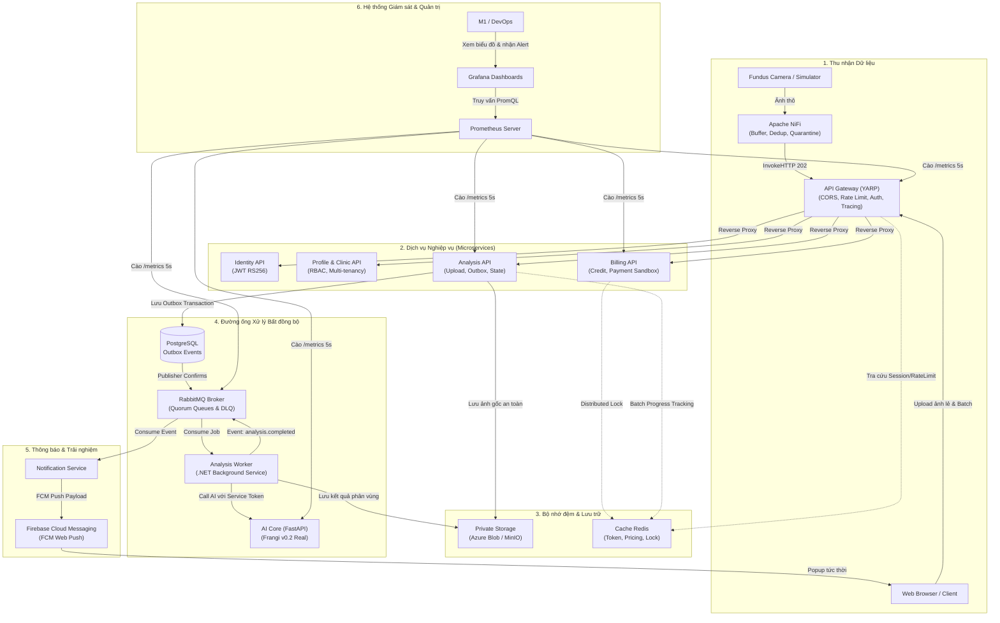

# Cẩm Nang Toàn Diện Về 7 Công Nghệ Cốt Lõi Trong Dự Án AURA
**Masterclass Kỹ Thuật: Bản Chất, Cơ Chế Vận Hành & Vai Trò Thực Tế Trong Hệ Thống Tầm Soát Võng Mạc AURA**

> **Dành cho**: Đội ngũ Kỹ thuật & Thành viên dự án AURA (`SP26SE025`)
> **Tác giả biên soạn**: Nguyễn Trương Hậu (Lead Architect / DevOps — M1)
> **Mục tiêu**: Nắm vững bản chất lý thuyết, cách thức hoạt động bên dưới (Under the hood), vai trò cụ thể trong dự án và tự tin trả lời vấn đáp / bảo vệ đồ án tốt nghiệp.

---

## MỤC LỤC TỔNG QUAN

1. [Bức tranh Tổng thể: 7 Công nghệ Phối hợp với nhau như thế nào?](#1-bức-tranh-tổng-thể)
2. [Công nghệ 1: Microservices & API Gateway (Kiến trúc phân tán)](#2-microservices--api-gateway)
3. [Công nghệ 2: OpenAPI & Swagger (Hợp đồng thiết kế API First)](#3-openapi--swagger)
4. [Công nghệ 3: Apache NiFi (Thu nhận dữ liệu từ Camera & Tự động hóa Luồng)](#4-apache-nifi)
5. [Công nghệ 4: RabbitMQ (Message Broker & Xử lý Bất đồng bộ)](#5-rabbitmq)
6. [Công nghệ 5: Cache Redis (Bộ nhớ đệm Tốc độ cao & Khóa phân tán)](#6-cache-redis)
7. [Công nghệ 6: Firebase Cloud Messaging - FCM (Đẩy thông báo tức thời)](#7-firebase-cloud-messaging---fcm)
8. [Công nghệ 7: Prometheus & Grafana (Giám sát Thời gian thực & Cảnh báo)](#8-prometheus--grafana)
9. [Bộ Câu Hỏi & Đáp Án Vấn Đáp / Bảo Vệ Đồ Án Hay Gặp](#9-bộ-câu-hỏi-vấn-đáp-bảo-vệ-đồ-án)

---

## 1. BỨC TRANH TỔNG THỂ

Trong một hệ thống y tế hiện đại như **AURA (Hệ thống Tầm soát Mạch máu Võng mạc)**, dữ liệu ảnh đáy mắt (Fundus) dung lượng lớn di chuyển qua nhiều thành phần từ máy chụp thực tế đến bác sĩ và bệnh nhân. 7 công nghệ này không đứng riêng lẻ mà đóng vai trò như các cơ quan trong một cơ thể sống:

---

## 2. MICROSERVICES & API GATEWAY

### A. Bản chất công nghệ là gì?
* **Kiến trúc Nguyên khối (Monolith)**: Đóng toàn bộ logic xác thực, bệnh nhân, xử lý ảnh, tính toán AI, hóa đơn vào một file code và chạy trên 1 server duy nhất.
  *Nhược điểm*: Khi mô hình AI chạy hết CPU/RAM thì toàn bộ web bị treo cứng; sửa lỗi nhỏ ở chức năng thanh toán cũng phải build lại toàn bộ hệ thống.
* **Kiến trúc Microservices**: Chia nhỏ hệ thống thành các dịch vụ độc lập, mỗi dịch vụ phụ trách một nghiệp vụ duy nhất (Single Responsibility) và sở hữu cơ sở dữ liệu riêng biệt.
* **API Gateway**: Là "người bảo vệ" đứng ở cửa ngõ. Thay vì các client (Web, Mobile, NiFi) phải nhớ địa chỉ IP của từng microservice, client chỉ cần gửi request đến API Gateway. Gateway sẽ:
  * **Reverse Proxy & Routing**: Điều hướng request tới đúng service bên trong.
  * **Authentication**: Kiểm tra Bearer Token trước khi cho phép đi tiếp.
  * **Rate Limiting**: Giới hạn số request/phút để chống spam và DDoS.
  * **Correlation ID**: Đính kèm một mã UUID truy vết duy nhất vào request header để theo dõi hành trình của request qua các service.

### B. Vai trò trong dự án AURA
* **Công nghệ sử dụng**: **Microsoft YARP (Yet Another Reverse Proxy)** viết trên .NET 10 tại thư mục `src/gateway/AURA.ApiGateway`.
* **Phân rã các dịch vụ trong AURA**:
  1. `Identity API` (Port 5003): Quản lý đăng ký/đăng nhập, phát hành token bảo mật RSA 3072 bit.
  2. `Profile API` (Port 5002): Quản lý hồ sơ bác sĩ, bệnh nhân, thông tin phòng khám (Clinic).
  3. `Analysis API` (Port 5001): Quản lý vòng đời ảnh chụp võng mạc, batch processing và bảng Outbox.
  4. `Billing API` (Port 5004): Quản lý nạp tiền, số dư ví Credit và lịch sử giao dịch.
  5. `AI Core` (Port 8000): Chạy thuật toán AI phân tích hình thái học bằng Python (FastAPI).
* **Lợi ích sống còn**: Tách biệt hoàn toàn tính toán AI nặng nề (Python) ra khỏi nghiệp vụ lưu trữ giao dịch (.NET). Kể cả khi AI Core đang xử lý 100 ảnh nặng, người dùng vẫn có thể đăng nhập, xem hồ sơ và nạp tiền bình thường mà không bị ảnh hưởng.

---

## 3. OPENAPI & SWAGGER

### A. Bản chất công nghệ là gì?
* **OpenAPI Specification (OAS)**: Là một định dạng chuẩn quốc tế (viết bằng YAML hoặc JSON) dùng để mô tả chi tiết giao diện của một REST API mà không phụ thuộc vào ngôn ngữ lập trình. Nó quy định: URL endpoint, phương thức (GET, POST), tham số đầu vào, cấu trúc body và các mã lỗi trả về (HTTP Status Codes).
* **Swagger**: Là bộ công cụ trực quan hóa file OpenAPI thành một trang web giao diện thân thiện (Swagger UI) cho phép lập trình viên đọc tài liệu và bấm nút "Try it out" để gửi request thử nghiệm trực tiếp trên trình duyệt.
* **Triết lý "API-First (Contract-First)"**: Thay vì nhảy vào viết code ngay rồi mới viết tài liệu sau, đội ngũ kỹ thuật sẽ cùng ngồi lại **thống nhất file OpenAPI trước**. Khi file này được duyệt, các thành viên backend và frontend có thể phát triển song song độc lập.

### B. Vai trò trong dự án AURA
* **Tài liệu hợp đồng trong dự án**:
  * [`contracts/analysis-openapi.yaml`](file:///c:/Users/nguye/OneDrive/Desktop/New%20folder/XD-PMHDT/contracts/analysis-openapi.yaml): Quy định hợp đồng của Analysis Service.
  * [`contracts/ai-openapi-1.2.yaml`](file:///c:/Users/nguye/OneDrive/Desktop/New%20folder/XD-PMHDT/contracts/ai-openapi-1.2.yaml): Quy định hợp đồng của AI Core Service.
* **Nhiệm vụ trong dự án**:
  * **Giải quyết mâu thuẫn giữa M2 (.NET) và M4 (Python)**: M2 viết Worker bằng C# (.NET) gọi sang AI Core viết bằng Python (FastAPI). Nhờ có OpenAPI, M2 biết chính xác AI Core cần nhận trường `image_base64`, `mode="retina_vessels"` và trả về cấu trúc `metrics.vessel_density`.
  * **Chuẩn hóa mã lỗi**: Quy định thống nhất `400 Bad Request` (ảnh hỏng), `401 Unauthorized` (thiếu token), `422 Unprocessable Entity` (ảnh kém chất lượng `LOW_QUALITY_IMAGE` hoặc gửi sai modality), `503 Service Unavailable` (chưa tải được model).
  * Giúp **M5 (Frontend)** dùng Swagger UI để test dữ liệu giả lập (mock data) ngay cả khi backend chưa triển khai xong.

---

## 4. APACHE NIFI

### A. Bản chất công nghệ là gì?
* **Apache NiFi**: Là nền tảng mã nguồn mở hàng đầu thế giới chuyên về **Tự động hóa luồng dữ liệu (Dataflow Automation)** giữa các hệ sinh thái khác nhau. NiFi cung cấp giao diện đồ họa kéo thả trực quan để thiết lập đường đi của dữ liệu.
* **Các khái niệm cốt lõi**:
  * **FlowFile**: Đơn vị dữ liệu cơ bản trong NiFi, bao gồm **Nội dung (Content - ví dụ bytes của file ảnh)** và **Thuộc tính (Attributes - ví dụ filename, filesize, timestamp)**.
  * **Processor**: Khối xử lý thực hiện một hành động cụ thể (ví dụ: `GetFile` đọc ảnh từ ổ đĩa, `HashContent` băm SHA-256, `InvokeHTTP` gửi request HTTP, `RouteOnAttribute` rẽ nhánh luồng dữ liệu).
  * **Backpressure**: Cơ chế tự động hãm phanh chống nghẽn; nếu hệ thống đích xử lý chậm, NiFi sẽ tạm ngưng nhận dữ liệu từ nguồn để tránh sập bộ nhớ.
  * **Data Provenance**: Tính năng "hộp đen máy bay" ghi lại chi tiết từng giây từng phút từng FlowFile đã đi qua processor nào, bị biến đổi ra sao và đi về đâu.

### B. Vai trò trong dự án AURA
* **Container đang chạy**: `aura-s3-nifi-1` (Port HTTPS `8543`).
* **Nhiệm vụ cụ thể trong dự án**:
  * **Cầu nối thu nhận ảnh từ Thiết bị chụp đáy mắt (Fundus Camera Ingestion)**: Máy chụp võng mạc tại phòng khám sau khi chụp sẽ xuất file ảnh thô vào một thư mục mạng. NiFi tự động phát hiện file ảnh mới $\rightarrow$ kiểm tra tính toàn vẹn $\rightarrow$ tính băm SHA-256 để chống gửi trùng lặp (Deduplication).
  * **Cơ chế cách ly ảnh lỗi (Quarantine)**: Nếu ảnh bị mờ, hỏng header, sai định dạng hoặc quá dung lượng, NiFi không gửi vào hệ thống chính mà tự động rẽ nhánh đưa vào thư mục cách ly `Quarantine` và ghi log cảnh báo cho kỹ thuật viên.
  * **Giao tiếp an toàn với API Gateway**: NiFi sử dụng processor `InvokeHTTP` gắn token bảo mật để gọi vào Gateway, nhận mã `HTTP 202 Accepted` và ghi biên lai nhận ảnh (Receipt) vào database `Reporting Postgres`.
  * *Tại sao không để Camera gọi thẳng vào Backend?* Vì môi trường phòng khám mạng có thể chập chờn, máy chụp ảnh có thể ngắt kết nối bất cứ lúc nào. NiFi hoạt động như một **vùng đệm kiên cố (Resilient Buffer)** đảm bảo không bao giờ làm mất ảnh bệnh nhân.

---

## 5. RABBITMQ

### A. Bản chất công nghệ là gì?
* **RabbitMQ**: Là một **Hệ thống điều phối hàng đợi thông điệp (Message Broker)** triển khai giao thức chuẩn công nghiệp AMQP (Advanced Message Queuing Protocol).
* **Mô hình hoạt động**:
  * **Producer**: Người phát thông điệp (ví dụ: API nhận ảnh xong phát ra tin nhắn "Đã có ảnh mới").
  * **Exchange**: Nơi tiếp nhận thông điệp và quyết định định tuyến (Direct, Topic, Fanout) dựa vào **Routing Key**.
  * **Queue**: Hàng đợi lưu trữ thông điệp trên đĩa cứng hoặc bộ nhớ.
  * **Consumer**: Ứng dụng lắng nghe hàng đợi và nhận thông điệp về xử lý (ví dụ: Worker nhận job để gọi AI).
  * **Quorum Queues**: Loại hàng đợi hiện đại của RabbitMQ sử dụng thuật toán đồng thuận Raft, đảm bảo dữ liệu tin nhắn được nhân bản an toàn, không bị mất ngay cả khi server bị tắt đột ngột.
  * **Dead Letter Exchange (DLX / DLQ)**: "Bệnh viện cấp cứu" cho các thông điệp bị lỗi; nếu một tin nhắn bị xử lý lỗi quá số lần quy định (ví dụ 10 lần) hoặc bị từ chối (NACK), nó được chuyển tự động vào DLQ để kỹ thuật viên kiểm tra thủ công thay vì làm nghẽn hàng đợi chính.

### B. Vai trò trong dự án AURA
* **Container đang chạy**: `aura-s3-rabbitmq-1` (AMQP Port `5672`, Management UI `127.0.0.1:15372`, vhost `/aura-s3`).
* **Topology**: 10 Exchanges, 11 Quorum Queues (`aura.s3.analysis.jobs`, `aura.s3.billing.events`...).
* **Nhiệm vụ cụ thể trong dự án**:
  * **Phá vỡ nút thắt cổ chai xử lý đồng bộ (Decoupling & Asynchronous Processing)**:
    * *Nếu không có RabbitMQ*: Khi người dùng upload 1 bức ảnh, request HTTP phải giữ kết nối chờ AI chạy thuật toán Frangi mất $2.5$ giây. Nếu 100 người upload cùng lúc, server sẽ hết sạch tài nguyên luồng (Thread Starvation) và sập hoàn toàn.
    * *Khi có RabbitMQ*: Người dùng upload ảnh $\rightarrow$ Analysis API lưu ảnh vào ổ cứng và lưu 1 bản ghi vào bảng Outbox $\rightarrow$ Trả về ngay lập tức cho người dùng `HTTP 202: Đã tiếp nhận ảnh` trong vòng $0.1$ giây! Sau đó, Outbox Publisher đẩy một Job vào queue `aura.s3.analysis.jobs`. Cụm Worker sẽ từ từ lấy từng ảnh ra gửi cho AI Core xử lý.
  * **Chống mất dữ liệu bằng Transactional Outbox Pattern**: Lưu bản ghi sự kiện vào cùng Database Transaction với ảnh. Nếu mất kết nối với RabbitMQ, sự kiện vẫn nằm an toàn trong database; khi mạng có lại, Publisher sẽ quét và đẩy tiếp.
  * **Bảo vệ tài chính**: Sau khi AI phân tích xong, sự kiện `analysis.completed` được phát lên RabbitMQ để Billing Service nhận và trừ đúng 1 credit của người dùng.

---

## 6. CACHE REDIS

### A. Bản chất công nghệ là gì?
* **Redis (Remote Dictionary Server)**: Là hệ quản trị cơ sở dữ liệu NoSQL lưu trữ hoàn toàn trên bộ nhớ RAM (In-Memory Key-Value Data Store).
* **Đặc tính vượt trội**:
  * Tốc độ đọc ghi siêu tốc: Đạt hàng trăm ngàn lượt đọc/ghi mỗi giây với độ trễ cực thấp ($< 1$ millisecond), nhanh gấp hàng trăm lần so với việc truy vấn đĩa cứng trên PostgreSQL.
  * Cơ chế bền vững (Persistence): Hỗ trợ ghi log AOF (Append-Only File) và chụp ảnh Snapshot (RDB) xuống đĩa để không bị mất dữ liệu khi restart server.
  * Khóa phân tán (Distributed Lock): Tính năng thực thi các phép toán nguyên tử (Atomic Operations) như `SET key value NX PX 10000` (chỉ đặt nếu chưa tồn tại kèm thời gian hết hạn).

### B. Vai trò trong dự án AURA
* **Nhiệm vụ 1: Chống tấn công & Kiểm soát lưu lượng tại API Gateway (Rate Limiting)**:
  * Mỗi khi một IP hoặc một User gửi request, Gateway ghi nhận vào Redis: `INCR rate:user:123`.
  * Nếu trong vòng 1 phút mà đếm vượt quá 100 request, Gateway tự động chặn lại và trả về mã lỗi `HTTP 429 Too Many Requests` mà không cần phải truy vấn vào Database chính.
* **Nhiệm vụ 2: Chống trừ tiền trùng lặp & Replay Attack (Distributed Lock & Idempotency)**:
  * Khi cổng thanh toán Sandbox gửi Webhook nạp tiền hoặc khi Worker trừ credit, service sẽ xin một khóa trên Redis: `SET lock:payment:order_999 1 NX EX 30`.
  * Nếu một hacker cố tình gửi lặp 2 request thanh toán cùng 1 lúc (Double-click/Replay), chỉ có request đầu tiên lấy được khóa để cộng tiền; request thứ hai bị từ chối ngay lập tức vì không lấy được khóa.
* **Nhiệm vụ 3: Theo dõi tiến độ Batch thời gian thực (Real-time Progress Tracker)**:
  * Khi phòng khám tải lên 1 đợt chụp 100 ảnh, Redis lưu trữ một Hash: `HSET batch:batch_001 total 100 completed 0 failed 0`.
  * Mỗi khi một Worker phân tích xong 1 ảnh, Worker chỉ cần gọi `HINCRBY batch:batch_001 completed 1`.
  * Trình duyệt Web của bác sĩ chỉ cần polling dữ liệu siêu nhẹ từ Redis để nhảy thanh tiến trình (0% $\rightarrow$ 100%) mà không làm tê liệt cơ sở dữ liệu PostgreSQL chính.

---

## 7. FIREBASE CLOUD MESSAGING (FCM)

### A. Bản chất công nghệ là gì?
* **Firebase Cloud Messaging (FCM)**: Là giải pháp hạ tầng thông báo đẩy (Push Notification) miễn phí, an toàn và đa nền tảng được phát triển bởi Google.
* **Cơ chế hoạt động**:
  * Không giống như cơ chế Polling (trình duyệt cứ 2 giây phải hỏi server một lần xem có tin gì mới không $\rightarrow$ gây tốn pin, tốn băng thông server), FCM sử dụng một kết nối ngầm siêu nhẹ (Persistent Socket) được Google duy trì trực tiếp với hệ điều hành và trình duyệt.
  * Khi Backend muốn gửi tin: Backend gọi API của Google FCM kèm **FCM Device Token** $\rightarrow$ Google FCM đẩy thông báo xuống thiết bị của người dùng ngay lập tức thông qua **Service Worker** chạy nền.

### B. Vai trò trong dự án AURA
* **Nhiệm vụ cụ thể trong dự án**:
  * **Đẩy thông báo kết quả khám tức thời (Instant Web Push)**:
    1. Bệnh nhân sau khi chụp đáy mắt có thể tắt máy tính hoặc chuyển sang lướt báo ở tab khác.
    2. Khi hệ thống AI và Bác sĩ hoàn thành đánh giá $\rightarrow$ Notification Service lắng nghe sự kiện từ RabbitMQ.
    3. Notification Service sử dụng Firebase Admin SDK bắn một gói tin Push Notification tới Google FCM.
    4. Trình duyệt của bệnh nhân lập tức hiện một cửa sổ thông báo (Pop-up Toast) góc màn hình:
       *🔔 "Hệ thống AURA: Kết quả tầm soát mắt của bạn đã hoàn tất! Bấm để xem phân tích mạch máu."*
    5. Người dùng click vào thông báo $\rightarrow$ Trình duyệt tự động mở tab mới và điều hướng thẳng vào trang kết quả có hiển thị hình ảnh mạch máu võng mạc.
  * **Thông báo biến động số dư**: Thông báo ngay khi nạp tiền thành công hoặc khi phòng khám được hoàn trả credit do có ảnh lỗi trong đợt tầm soát.

---

## 8. PROMETHEUS & GRAFANA

### A. Bản chất công nghệ là gì?
* **Prometheus**: Là hệ sinh thái giám sát (Monitoring) và cảnh báo dựa trên cơ sở dữ liệu chuỗi thời gian (Time-series Database).
  * **Cơ chế Pull (Scraping)**: Khác với các hệ thống giám sát kiểu cũ chờ ứng dụng gửi log về, Prometheus hoạt động bằng cách chủ động gõ cửa định kỳ (ví dụ mỗi 5 giây) vào endpoint `/metrics` của từng microservice để "kéo" dữ liệu thống kê về lưu trữ.
  * **PromQL**: Ngôn ngữ truy vấn mạnh mẽ cho phép tính toán tỷ lệ lỗi, độ trễ p95, p99 và tốc độ tăng trưởng dữ liệu.
  * **Alertmanager**: Phân hệ xử lý cảnh báo, tự động gửi thông báo qua Email, Slack, Telegram khi có sự cố.
* **Grafana**: Là công cụ hiển thị trực quan hóa dữ liệu (Data Visualization) hàng đầu thế giới. Grafana kết nối vào Prometheus để biến các con số thống kê khô khan thành các biểu đồ đo tải, đồng hồ áp suất, bản đồ nhiệt thời gian thực cực kỳ trực quan và bắt mắt.

### B. Vai trò trong dự án AURA
* **Vị trí trong hệ thống**: Là "Trung tâm chỉ huy & Mắt thần" của M1 (Lead Architect / DevOps).
* **Nhiệm vụ cụ thể trong dự án**:
  * **Giám sát tải Microservices theo Mô hình RED**:
    * **R**ate: Đo lường số lượng request mỗi giây (Throughput) mà API Gateway đang xử lý.
    * **E**rrors: Giám sát tỷ lệ lỗi HTTP 4xx và 5xx. Nếu tỷ lệ lỗi server vượt quá 2%, hệ thống kích hoạt cảnh báo đỏ.
    * **D**uration: Đo lường độ trễ phản hồi của hệ thống. Giám sát xem thuật toán phân vùng Frangi của AI Core mất trung bình bao nhiêu giây (đảm bảo $< 1.8$ giây).
  * **Giám sát Hàng đợi RabbitMQ (Queue Health Dashboard)**:
    * Theo dõi xem có bao nhiêu job đang xếp hàng trong queue `aura.s3.analysis.jobs`.
    * Nếu số lượng job tồn đọng tăng vọt $> 50$ tin nhắn mà không giảm $\rightarrow$ Grafana cảnh báo M1 biết các Worker đang bị quá tải để bật thêm container Worker chi viện.
  * **Bảo vệ tài nguyên phần cứng**: Giám sát mức tiêu thụ RAM của PostgreSQL và AI Core, ngăn ngừa sự cố container bị sập đột ngột do hết RAM (Out-Of-Memory / OOMKilled).

---

## 9. BỘ CÂU HỎI VẤN ĐÁP / BẢO VỆ ĐỒ ÁN HAY GẶP

Dưới đây là các câu hỏi hóc búa mà Hội đồng phản biện hoặc Nhà tuyển dụng rất hay hỏi và cách trả lời chuẩn chỉ theo phong cách Tech Lead:

#### Câu 1: "Tại sao trong dự án lại cần dùng cả RabbitMQ và Redis, sao không dùng luôn Redis làm Message Queue?"
> **Trả lời**:
> "Redis và RabbitMQ phục vụ hai mục đích kiến trúc hoàn toàn khác nhau:
> - **Redis** là bộ nhớ đệm In-Memory tối ưu cho việc truy xuất dữ liệu cực nhanh với độ trễ dưới 1 mili-giây, rất phù hợp cho **Rate Limiting, Session Blacklist, Khóa phân tán (Distributed Lock) và theo dõi tiến độ Batch**.
> - **RabbitMQ** là một Message Broker chuyên biệt đạt chuẩn AMQP, cung cấp cơ chế **Quorum Queues đảm bảo độ bền vững tuyệt đối của thông điệp, Publisher Confirms xác nhận gửi an toàn, định tuyến phức tạp (Topic/Direct Exchange) và Dead Letter Queue (DLQ)** để cách ly các tin nhắn lỗi độc hại (Poison messages).
> Dữ liệu khám bệnh đáy mắt của bệnh nhân là dữ liệu y tế quan trọng không thể đánh rơi; nếu chỉ dùng Redis làm queue, khi Redis gặp sự cố hoặc tràn RAM có thể dẫn đến mất job phân tích. Vì vậy, nhóm dùng RabbitMQ làm xương sống điều phối xử lý bất đồng bộ, và dùng Redis làm tầng đệm tăng tốc."

#### Câu 2: "Cơ chế Transactional Outbox Pattern ở M2 giải quyết vấn đề gì?"
> **Trả lời**:
> "Trong kiến trúc microservices, khi lưu ảnh vào database và phát thông điệp sang RabbitMQ, hệ thống gặp phải bài toán **Dual-Write (Ghi hai nơi)**: Nếu ta lưu database thành công nhưng mạng bị ngắt khiến không gửi được message sang RabbitMQ, ảnh của bệnh nhân sẽ bị 'mồ côi' và không bao giờ được phân tích. Ngược lại, nếu gửi message sang RabbitMQ trước rồi mới lưu database, nếu database bị lỗi thì Worker sẽ nhận một job không hề tồn tại.
> Để giải quyết triệt để, nhóm triển khai **Transactional Outbox Pattern**: Bản ghi sự kiện được lưu vào bảng `analysis.outbox_events` nằm trong cùng một Database Transaction với ảnh. Nhờ tính chất ACID của PostgreSQL, hoặc cả hai cùng thành công, hoặc cả hai cùng rollback. Sau đó, tiến trình Outbox Publisher sẽ đọc bảng này và gửi sang RabbitMQ với Publisher Confirms; chỉ khi RabbitMQ báo ACK thì mới cập nhật trạng thái `published_at`."

#### Câu 3: "Tại sao NiFi lại nhận ảnh qua HTTP 202 Accepted mà không phải HTTP 200 OK?"
> **Trả lời**:
> "Mã `HTTP 200 OK` có nghĩa là yêu cầu đã được xử lý hoàn tất trọn vẹn và có kết quả cuối cùng. Trong khi đó, việc chụp và phân tích mạch máu võng mạc là một quy trình bất đồng bộ kéo dài nhiều bước (chạy Frangi lọc ảnh, bác sĩ xem xét).
> Khi NiFi gửi ảnh sang API Gateway, Gateway và Analysis API trả về mã **`HTTP 202 Accepted`**. Mã này chuẩn hóa theo RFC 7231, mang ý nghĩa: *'Hệ thống đã tiếp nhận yêu cầu hợp lệ và đã lưu trữ ảnh an toàn, nhưng quá trình xử lý AI chưa diễn ra'*. Điều này giúp client hoặc camera không phải treo luồng chờ đợi, đúng với bản chất kiến trúc hướng sự kiện (Event-driven)."

#### Câu 4: "Kiến trúc bảo mật giữa các Microservices được bảo vệ như thế nào?"
> **Trả lời**:
> "Hệ thống AURA áp dụng mô hình bảo mật **Zero Trust (Không tin tưởng ngầm)** và nguyên tắc **Fail-Closed**:
> 1. Client bên ngoài giao tiếp với API Gateway qua giao thức HTTPS và Bearer Token người dùng do Identity API cấp.
> 2. Giữa các microservices nội bộ (ví dụ Worker gọi sang AI Core), hệ thống không tin tưởng tự động chỉ vì cùng nằm trong mạng Docker. Thay vào đó, Worker bắt buộc phải có một **Service JWT Token** ký bằng thuật toán mã hóa bất đối xứng **RS256 (RSA 2048/3072 bit)**.
> 3. AI Core sở hữu Public Key để tự giải mã và kiểm tra: đúng Issuer (`aura-identity-s3-v1`), đúng Audience (`aura-ai`) và đúng Scope (`ai:analyze`). Nếu không nạp được khóa công khai hoặc token sai chữ ký, AI Core lập tức từ chối với mã lỗi `401 Unauthorized` hoặc `503 Service Unavailable`, không cho phép bất kỳ ai can thiệp trái phép vào thuật toán phân tích."

#### Câu 5: "Prometheus thu thập dữ liệu bằng cơ chế Push hay Pull? Tại sao lại chọn cơ chế đó?"
> **Trả lời**:
> "Prometheus sử dụng cơ chế **Pull Model** (Prometheus định kỳ chủ động gọi đến endpoint `/metrics` của từng service để cào dữ liệu về).
> Nhóm chọn cơ chế Pull vì các ưu điểm kiến trúc vượt trội:
> 1. **Kiểm soát được tải của hệ thống giám sát**: Prometheus chủ động quyết định tần suất cào dữ liệu (ví dụ 5s/lần), không sợ bị các microservices 'dội bom' metrics làm sập server giám sát khi hệ thống đang chịu tải cao.
> 2. **Dễ dàng phát hiện dịch vụ bị chết (Healthcheck tự nhiên)**: Nếu Prometheus gọi đến `/metrics` của Analysis API mà bị timeout hoặc connection refused, Prometheus biết ngay lập tức dịch vụ đó đang gặp sự cố và kích hoạt cảnh báo Alertmanager.
> 3. **Đơn giản hóa mã nguồn microservices**: Microservice chỉ cần mở 1 endpoint `/metrics` trả về văn bản thống kê đơn giản, không cần phải cấu hình phức tạp địa chỉ server nhận log hay xử lý retry khi gửi metric."
