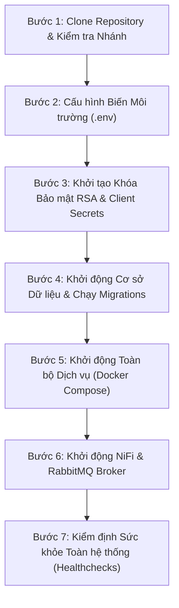

# Hướng dẫn Cài đặt và Vận hành Hệ thống AURA (Installation & Operations Manual)

> **Đồ án môn học**: Xây dựng Phần mềm Hướng đối tượng (XD-PMHDT)
> **Dự án**: AURA — Hệ thống sàng lọc sức khỏe mạch máu võng mạc qua ảnh chụp đáy mắt (Fundus)
> **Gói công việc**: **Task Package 5 (Required Documents)** & **SCRUM-319 (M1 DevOps Handover)**
> **Tác giả (M1)**: Nguyễn Trương Hậu (Lead Architecture / Platform / DevOps)
> **Phiên bản tài liệu**: v1.0.0 · Tháng 10/2026
> **Đối tượng sử dụng**: Hội đồng phản biện (Viva Committee), Giảng viên hướng dẫn, Kỹ sư triển khai và Vận hành (DevOps / SRE)

---

## 1. Giới thiệu Tổng quan Hệ thống

Hệ thống **AURA** áp dụng kiến trúc Microservices phân tán hiện đại, kết hợp trí tuệ nhân tạo (AI) và luồng xử lý dữ liệu thời gian thực (ETL Stream):
- **Giao diện người dùng (Frontend)**: Web App xây dựng bằng React 18, Vite, TypeScript, TailwindCSS.
- **Cổng giao tiếp API (Gateway)**: YARP (Yet Another Reverse Proxy) trên .NET 10 (Cổng `5000`), định tuyến request và bảo mật.
- **Hệ thống Microservices Backend**: .NET 10 (Analysis API `5001`, Billing API `5002`, Notification API `5003`, Identity API `5004`, Profile API `5005`).
- **AI Core Service**: Python 3.12 (FastAPI, cổng `8000`), tích hợp thuật toán phân đoạn mạch máu võng mạc **Frangi Filter v0.2**.
- **Điều phối thông điệp (Message Broker)**: RabbitMQ 4.3.6 (Cổng AMQP `5672`, Mgmt `15672` / `15372`), cụm 11 Quorum Queues, Dead Letter Queues (DLQ) và Retry có trễ (TTL).
- **Thu nhận ảnh từ Camera đáy mắt (Image Ingestion)**: Apache NiFi 1.27 (HTTPS cổng `8543`), kiểm định hợp đồng dữ liệu y tế, cô lập ảnh lỗi (Quarantine).
- **Cơ sở dữ liệu & Lưu trữ**:
  - PostgreSQL 17: Phân tách 6 schema độc lập (`analysis`, `billing`, `identity`, `profile`, `notification`, `reporting`).
  - Redis 7.4: Caching và quản lý phiên làm việc.
  - Azurite / Azure Blob Storage: Lưu trữ ảnh chụp Fundus và ảnh mặt nạ phân đoạn (Mask/Overlay) riêng tư.

---

## 2. Yêu cầu Môi trường & Phần cứng (Prerequisites)

### 2.1. Cấu hình Phần cứng Tối thiểu & Đề xuất

| Thành phần | Yêu cầu Tối thiểu | Cấu hình Đề xuất (Khuyên dùng) |
|---|---|---|
| **Bộ vi xử lý (CPU)** | 4 Cores (x86_64) | 8–12 Cores |
| **Bộ nhớ trong (RAM)** | 8.0 GB RAM | 16.0 GB RAM (Tối thiểu 4.0 GB trống cho Docker) |
| **Dung lượng Ổ cứng** | 30 GB SSD khả dụng | 60 GB NVMe SSD |
| **Hệ điều hành** | Windows 10/11 Pro (WSL 2) hoặc Ubuntu 22.04/24.04 LTS | Windows 11 Pro 64-bit hoặc Linux |

### 2.2. Phần mềm & Công cụ Bắt buộc Cần Cài đặt
1. **Docker Desktop** (Phiên bản $\ge$ 4.30) với Docker Engine $\ge$ 26.0 và Docker Compose v2.
2. **.NET SDK 10.0** (Cần thiết nếu muốn chạy unit test và migration công cụ cục bộ).
3. **Python 3.12** với trình quản lý gói `pip`.
4. **Node.js** (Phiên bản LTS $\ge$ 20.x) và trình quản lý `npm`.
5. **Git** phiên bản $\ge$ 2.40.
6. **PowerShell 7** (trên Windows) hoặc Bash shell (trên Linux).

---

## 3. Quy trình Triển khai Hệ thống Từng Bước (Installation Steps)



### Bước 1: Tải Mã nguồn Dự án
Mở terminal và thực hiện clone dự án từ GitHub:
```bash
git clone https://github.com/CattyGame/XD-PMHDT.git
cd XD-PMHDT
git checkout develop
```

### Bước 2: Thiết lập File Biến Môi trường
Tạo file `.env` từ file mẫu `.env.example`:
```bash
# Trên Windows PowerShell:
Copy-Item .env.example .env

# Trên Linux/macOS:
cp .env.example .env
```
*Lưu ý*: Mọi giá trị mật khẩu mặc định trong `.env.example` đã được cấu hình sẵn cho môi trường phát triển (Development). Đối với môi trường Staging/Production, bắt buộc phải thay đổi các chuỗi mật khẩu mạnh ngẫu nhiên.

### Bước 3: Khởi tạo Khóa Ký Bảo mật RSA 3072 & Service Tokens
Chạy công cụ cấp phát danh tính dịch vụ tự động để tạo cặp khóa RSA và sinh mã băm bí mật cho 7 dịch vụ nội bộ:
```powershell
dotnet run --project tools/AURA.ServiceIdentity.Setup/AURA.ServiceIdentity.Setup.csproj `
  --configuration Release `
  --registry ./infra/service-auth/clients.example.json `
  --output ./infra/service-auth/generated
```
Lệnh trên tạo ra:
- Cặp khóa RSA 3072-bit tại `./infra/service-auth/generated/public/signing-public.pem`.
- File cấu hình client cho từng service (`identity-api.json`, `analysis-api.json`, `billing-api.json`, `profile-api.json`).

### Bước 4: Khởi động Cơ sở Dữ liệu & Áp dụng Migrations
1. Khởi động PostgreSQL 17 và Redis:
   ```bash
   docker compose --env-file .env up -d --wait postgres redis
   ```
2. Thực thi toàn bộ 9 file migrations phân quyền theo thứ tự nghiêm ngặt:
   ```powershell
   ./scripts/dev/Initialize-AuraDevDatabase.ps1 -EnvFile .env
   ```
   *Quá trình này tự động tạo các bảng và gán quyền đặc quyền tối thiểu (Least Privilege) cho từng vai trò người dùng trong cơ sở dữ liệu.*

### Bước 5: Khởi động Cụm Microservices & AI Core
Khởi chạy API Gateway, AI Core, Identity, Profile, Analysis và Billing:
```bash
docker compose --env-file .env -f compose.yaml -f compose.dev.yaml up -d --build
```

### Bước 6: Khởi động RabbitMQ Broker & NiFi Ingestion
Khởi động cụm Broker RabbitMQ với Quorum topology và Apache NiFi Ingestion:
```bash
# Khởi động RabbitMQ Broker
docker compose -f infra/nifi/docker-compose.nifi.yml up -d
```
Đảm bảo 11 quorum queues và các Dead Letter Queues (`aura.s3.*`) được nạp từ định nghĩa `definitions.json`.

---

## 4. Kiểm tra Sức khỏe và Xác nhận Triển khai (Verification & Healthchecks)

Sau khi khởi động, kiểm tra các điểm truy cập để xác nhận hệ thống hoạt động bình thường:

### 4.1. Bảng Kiểm tra Endpoint (Verification Checklist)

| Dịch vụ | Địa chỉ kiểm tra | Trạng thái kỳ vọng | Ý nghĩa |
|---|---|:---:|---|
| **API Gateway (YARP)** | `GET http://localhost:5000/health` | `200 Healthy` | Gateway định tuyến sẵn sàng |
| **Analysis API** | `GET http://localhost:5001/health` | `200 Healthy` | Service xử lý tải lên ảnh sẵn sàng |
| **Analysis Ping API** | `GET http://localhost:5000/api/v1/platform/ping` | `200 OK` (JSON) | Gateway thông luồng vào Analysis API |
| **AI Core Service** | `GET http://localhost:8000/ready` | `200 OK` (JSON) | Model Frangi v0.2 đã nạp vào RAM |
| **RabbitMQ Management**| `http://localhost:15372` (hoặc `15672`) | Web Dashboard | 11 Quorum Queues trạng thái Active |
| **Apache NiFi UI** | `https://localhost:8543/nifi` | Web Canvas | Luồng Camera Ingestion sẵn sàng |
| **Frontend Web App** | `http://localhost:5173` | Giao diện Đăng nhập | Web React phục vụ bác sĩ / bệnh nhân |

### 4.2. Lệnh Kiểm tra Tự động Toàn diện
Chạy script kiểm định môi trường phát triển chính thức của M1:
```powershell
./scripts/dev/Test-AuraDevEnvironment.ps1 -CheckDevelopmentBootstrap
```
*Kết quả kỳ vọng*: Toàn bộ các kiểm tra kết nối cơ sở dữ liệu, mạng nội bộ, Gateway ping và AI Core đều báo **PASS**.

---

## 5. Hướng dẫn Vận hành và Khắc phục Sự cố (Operations & Troubleshooting Runbook)

### 5.1. Khi RabbitMQ Broker bị mất kết nối hoặc quá tải
- **Triệu chứng**: Analysis API không đẩy được sự kiện vào outbox hoặc Worker không nhận được job mới.
- **Biện pháp xử lý**:
  1. Kiểm tra cảnh báo tài nguyên của RabbitMQ:
     ```bash
     docker exec aura-s3-rabbitmq-1 rabbitmq-diagnostics -q check_running
     ```
  2. Xem danh sách các tin nhắn trong Dead Letter Queue:
     ```bash
     docker exec aura-s3-rabbitmq-1 rabbitmqctl list_queues name messages messages_ready | grep dead
     ```
  3. Nhờ cơ chế Outbox Pattern, các event chưa publish vẫn nằm an toàn trong bảng `analysis.outbox_events` và sẽ tự động gửi lại ngay khi Broker hoạt động trở lại.

### 5.2. Khi Apache NiFi không ghi được biên lai (Reporting Outage)
- **Triệu chứng**: Ảnh từ camera gửi đến cổng `8543` bị lưu lại trong hàng đợi hoặc chuyển sang nhánh HOLD.
- **Biện pháp xử lý**:
  1. Cơ chế Safe Writer v2 sẽ tự động retry tối đa 10 lần.
  2. Nếu vượt quá 10 lần, FlowFile được chuyển an toàn vào nhánh `Reconcile-Observed` mà không xóa ảnh hay làm mất biên nhận cũ.
  3. Khởi động lại Reporting Database và chạy lại kiểm định:
     ```powershell
     py -3.12 -B .\NiFi87C.py --check
     ```

### 5.3. Khởi động lại hệ thống an toàn (Clean Restart)
Khi bảo trì hoặc khởi động lại máy chủ, luôn thực hiện theo thứ tự:
1. **Dừng an toàn**:
   ```bash
   docker compose -f compose.yaml -f compose.dev.yaml stop
   ```
2. **Khởi động lại**:
   ```bash
   docker compose -f compose.yaml -f compose.dev.yaml start
   ```
*Lưu ý*: Tuyệt đối không dùng cờ `-v` khi `down` để tránh làm mất dữ liệu PostgreSQL và Azure Blob storage.

---

## 6. Kết luận & Hướng dẫn Bàn giao cho Hội đồng Phản biện

Hệ thống AURA đáp ứng đầy đủ các tiêu chuẩn kỹ thuật chuyên nghiệp:
- **Tính tự động hóa cao**: Khởi tạo hạ tầng, mã hóa dữ liệu, áp dụng schema và kiểm định toàn vẹn chỉ qua các lệnh chuẩn hóa.
- **Khả năng chịu lỗi và an ninh**: Sử dụng Quorum Queues, Outbox Pattern, Fail-Closed Service Authentication, phân quyền Role-Based Access Control chặt chẽ.
- **Sẵn sàng vận hành**: Đã kiểm chứng qua 456 bài test tự động và hoàn toàn sẵn sàng cho phiên trình bày đồ án thực tế trước hội đồng Viva.
