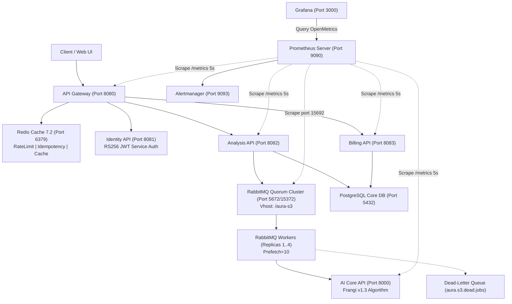

# Sổ tay Vận hành Hạ tầng Hệ thống AURA (Operations Runbook v1.2)

> **Tài liệu**: Hướng dẫn Vận hành, Giám sát, Bảo trì & Ứng phó Sự cố
> **Dự án**: AURA (`SP26SE025`) · **Phiên bản Runbook**: `v1.2` (Sprint 4 Bàn giao)
> **Tác giả / Lead Architect**: Nguyễn Trương Hậu (`M1`)
> **Đối tượng áp dụng**: Kỹ sư Vận hành Hạ tầng (DevOps), Site Reliability Engineers (SRE), và Lập trình viên Backend/AI.
> **Trạng thái**: Hoàn thiện & Khả dụng cho chuyển giao kỹ thuật (Handover Ready).

---

## 1. Kiến trúc Tổng quan Hạ tầng AURA Sprint 4



---

## 2. Quy trình Khởi động & Vận hành Hạ tầng (Operations Quickstart)

### 2.1. Bảng Phân bổ Cổng Mạng & Thông tin Đăng nhập Mặc định
| Thành phần | Cổng Host | Endpoint Kiểm tra | Tài khoản Mặc định | Mật khẩu / Secret |
|---|---|---|---|---|
| **API Gateway** | `8080` | `http://localhost:8080/health` | - | - |
| **Analysis API** | `8082` | `http://localhost:8082/metrics` | - | Service Token |
| **Billing API** | `8083` | `http://localhost:8083/metrics` | - | Service Token |
| **AI Core API** | `8000` | `http://localhost:8000/metrics` | - | RS256 Bearer |
| **RabbitMQ Console** | `15372` | `http://localhost:15372` | `s3-operator` | `aura_s3_operator_2026` |
| **RabbitMQ Metrics** | `15692` | `http://localhost:15692/metrics` | - | OpenMetrics |
| **Redis Cache** | `6379` | `redis-cli ping` | `default` | `aura_redis_secret_pass` |
| **Prometheus** | `9090` | `http://localhost:9090` | - | Không yêu cầu |
| **Alertmanager** | `9093` | `http://localhost:9093` | - | Không yêu cầu |
| **Grafana** | `3000` | `http://localhost:3000` | `admin` | `aura_grafana_secure_2026` |

### 2.2. Các Lệnh Khởi động Cụm theo Thứ tự Chuẩn

1. **Khởi động Cụm Cơ sở (Database, Broker, Identity, AI Core)**:
   ```bash
   docker compose up -d
   ```
2. **Khởi động Cụm Giám sát (Prometheus, Grafana, Alertmanager, Postgres Exporter)**:
   ```bash
   docker compose -f compose.monitoring.yaml up -d
   ```
3. **Khởi động Cụm Workers với Cơ chế Mở rộng (Scaling 4 Replicas)**:
   ```bash
   docker compose -f compose.workers.yaml up -d --scale analysis-worker=4
   ```
4. **Kiểm tra trạng thái toàn bộ containers**:
   ```bash
   docker ps --format "table {{.Names}}\t{{.Status}}\t{{.Ports}}"
   ```

---

## 3. Hướng dẫn Đọc hiểu & Sử dụng Grafana Dashboards

Đăng nhập Grafana tại `http://localhost:3000` với tài khoản `admin / aura_grafana_secure_2026`. Điều hướng đến mục **Dashboards** để chọn 3 giao diện giám sát sau:

### 3.1. Dashboard 1: AURA - System Overview & Resource Telemetry
- **Đường dẫn**: `Dashboards` -> `AURA System Overview`
- **Mục đích**: Cung cấp cái nhìn bao quát về sức tải của phần cứng máy chủ và các container đang chạy.
- **Các thông số trọng yếu**:
  - `Total Microservices Alive`: Số instance đang trong trạng thái Up (`up == 1`). Cần duy trì bằng tổng số service.
  - `Global Request Throughput`: Tổng số requests/giây của toàn bộ hệ thống.
  - `Global HTTP 5xx Error Rate`: Tỷ lệ lỗi máy chủ toàn cục. Ngưỡng bình thường: $< 0.1\%$; Cảnh báo nếu: $> 2.0\%$.
  - `Fleet Container Memory (MiB)`: Biểu đồ diện tích theo dõi mức RAM chiếm dụng của từng container so với ngưỡng trần 80%.

### 3.2. Dashboard 2: AURA - Microservices RED Metrics
- **Đường dẫn**: `Dashboards` -> `AURA Microservices RED Metrics`
- **Mục đích**: Giám sát dịch vụ dựa trên tiêu chuẩn RED (Rate, Errors, Duration) chuẩn công nghiệp:
  - **Rate (Thông lượng)**: Đo lường tốc độ gọi API (`sum(rate(http_requests_received_total[1m])) by (app)`).
  - **Errors (Tỷ lệ lỗi)**: Phân tách lỗi Client (4xx) và lỗi Server (5xx).
  - **Duration (Độ trễ phản hồi)**: Hiển thị 3 đường percentile thời gian thực:
    - $p_{50}$ (Trung vị): Thời gian phản hồi tiêu chuẩn của 50% người dùng.
    - $p_{95}$: Chỉ báo sớm về hiện tượng chậm chạp.
    - $p_{99}$: Chỉ báo các request ngoại lai cần tối ưu hóa.

### 3.3. Dashboard 3: AURA - RabbitMQ & Worker Health Telemetry
- **Đường dẫn**: `Dashboards` -> `AURA RabbitMQ Worker Health`
- **Mục đích**: Quản trị hàng đợi batch và năng lực xử lý của các Worker:
  - `Queue Backlog (Ready Messages)`: Số lượng job đang chờ worker thụ lý. Nếu $> 50$, cần scale thêm worker replica.
  - `Unacked Messages`: Số lượng job worker đang xử lý trong thời gian thực (giới hạn bởi `prefetch=10`).
  - `Message Delivery vs Ack Rate`: Đánh giá mức độ đồng bộ giữa tốc độ đẩy và tốc độ tiêu thụ.
  - `Dead-Letter Queue Depth (aura.s3.dead.jobs)`: **Bình thường phải bằng 0**. Nếu $> 0$, nghĩa là có job gặp sự cố nghiêm trọng bị đẩy về DLQ.

---

## 4. Quy trình Xử lý Cảnh báo Alertmanager (Alert Triage Runbook)

Alertmanager lắng nghe tại `http://localhost:9093`. Khi nhận cảnh báo, kỹ sư trực ca xử lý theo các bước sau:

### 4.1. Cảnh báo `AuraHighHttp5xxRate` (Mức độ: CRITICAL)
- **Triệu chứng**: Tỷ lệ lỗi HTTP 5xx vượt quá 2% trong hơn 2 phút.
- **Nguyên nhân tiềm ẩn**: Database PostgreSQL bị quá tải kết nối, AI Core bị timeout hoặc lỗi xác thực JWT.
- **Quy trình xử lý**:
  1. Kiểm tra log của service bị lỗi:
     ```bash
     docker logs --tail 100 <tên_container_lỗi>
     ```
  2. Kiểm tra tài nguyên RAM/CPU:
     ```bash
     docker stats --no-stream
     ```
  3. Nếu lỗi phát sinh do pool kết nối database bị nghẽn, kiểm tra số kết nối đang hoạt động:
     ```bash
     docker exec aura-pg87s-c4fdb65507bd41d9 psql -U postgres -d aura_dev -c "SELECT count(*) FROM pg_stat_activity;"
     ```

### 4.2. Cảnh báo `AuraAnalysisJobQueueBacklog` (Mức độ: WARNING)
- **Triệu chứng**: Hàng đợi `aura.s3.analysis.jobs` tích tụ trên 50 messages trong hơn 1 phút.
- **Nguyên nhân tiềm ẩn**: Đột biến lưu lượng tải gửi lên hoặc worker bị dừng xử lý.
- **Quy trình xử lý**:
  1. Kiểm tra số lượng worker đang online:
     ```bash
     docker compose -f compose.workers.yaml ps
     ```
  2. Ngay lập tức mở rộng quy mô (Scale-up) thêm replicas:
     ```bash
     docker compose -f compose.workers.yaml up -d --scale analysis-worker=8
     ```
  3. Theo dõi chỉ số `Queue Backlog` trên Grafana giảm dần về 0.

### 4.3. Cảnh báo `AuraServiceInstanceDown` (Mức độ: CRITICAL)
- **Triệu chứng**: Một microservice không phản hồi metric sau 15 giây.
- **Nguyên nhân tiềm ẩn**: Container bị crash do ngoại lệ chưa bắt hoặc bị OOMKilled.
- **Quy trình xử lý**:
  1. Kiểm tra container nào đã dừng:
     ```bash
     docker ps -a --filter "status=exited"
     ```
  2. Kiểm tra xem có bị OOM (Out Of Memory) hay không:
     ```bash
     docker inspect <tên_container> | grep -i oomkilled
     ```
  3. Khởi động lại container bị sự cố:
     ```bash
     docker start <tên_container>
     ```

---

## 5. Cẩm nang Quản trị Cache Redis Tập trung

Hệ thống Redis triển khai tại cổng `6379`, bảo vệ bằng mật khẩu `aura_redis_secret_pass`.

### 5.1. Cấu trúc Không gian Tên Khóa (Key Namespaces)
Mọi dữ liệu lưu trong Redis bắt buộc phải tuân theo tiền tố định danh để tránh xung đột dữ liệu:
- `gw:ratelimit:{ip|client_id}`: Bộ đếm giới hạn tốc độ truy cập tại API Gateway.
- `gw:session:{session_id}`: Phiên làm việc và trạng thái đăng nhập của người dùng.
- `billing:package:{package_id}`: Bộ nhớ đệm danh mục gói cước khám võng mạc (TTL = 300s).
- `billing:idempotency:{key}`: Khóa chống thanh toán trùng lặp (TTL = 86400s).
- `analysis:batch:{batch_id}`: Trạng thái tổng hợp tiến độ phân tích batch (TTL = 3600s).

### 5.2. Chính sách Thu hồi Bộ nhớ & Cấu hình Giới hạn (Eviction Policy)
- **Cấu hình trần RAM**: `maxmemory 512mb`
- **Chính sách giải phóng**: `maxmemory-policy volatile-lru` (Tự động thu hồi các khóa có thiết lập TTL theo thuật toán Least Recently Used khi chạm ngưỡng 512MB, tuyệt đối không làm mất dữ liệu vĩnh viễn).
- **Cơ chế bền vững**: Kích hoạt song song RDB Snapshots (`save 900 1`, `save 300 10`) và AOF (`appendonly yes`, `appendfsync everysec`).

### 5.3. Các Lệnh Quản trị Thường dùng
- **Đăng nhập vào CLI Redis**:
  ```bash
  docker exec -it <redis-container> redis-cli -a aura_redis_secret_pass
  ```
- **Kiểm tra thông số bộ nhớ và tỷ lệ Hit/Miss**:
  ```text
  127.0.0.1:6379> INFO memory
  127.0.0.1:6379> INFO stats
  ```
- **Tra cứu và kiểm tra TTL của một khóa**:
  ```text
  127.0.0.1:6379> TTL billing:package:standard-pack
  127.0.0.1:6379> GET billing:idempotency:bfa2c1e9-53d4-427d-ab8a-3a13e22a1819
  ```
- **Xóa cache theo tiền tố an toàn**:
  ```text
  127.0.0.1:6379> EVAL "for i, name in ipairs(redis.call('KEYS', 'billing:package:*')) do redis.call('DEL', name) end" 0
  ```

---

## 6. Cẩm nang Quản trị RabbitMQ & Xử lý Hàng đợi Chết (DLQ)

### 6.1. Hàng đợi Quorum & Chính sách Dead-Letter
Mọi hàng đợi xử lý quan trọng thuộc vhost `/aura-s3` đều là hàng đợi Quorum (`x-queue-type: quorum`). Khi một thông điệp bị reject với cờ `requeue = false` hoặc vượt quá số lần retry cho phép, RabbitMQ tự động đẩy vào Dead-Letter Exchange `aura.s3.dead.jobs`.

### 6.2. Kiểm tra Tin nhắn Sự cố trong DLQ
- Tra cứu trực tiếp bằng công cụ `rabbitmqctl`:
  ```bash
  docker exec aura-s3-rabbitmq-1 rabbitmqctl list_queues -p /aura-s3 name messages consumers
  ```
- Lấy mẫu payload tin nhắn bị lỗi qua Management API:
  ```bash
  curl -s -u s3-operator:aura_s3_operator_2026 -X POST \
    http://localhost:15372/api/queues/%2Faura-s3/aura.s3.dead.jobs/get \
    -H "Content-Type: application/json" \
    -d '{"count": 1, "ackmode": "ack_requeue_true", "encoding": "auto"}'
  ```

### 6.3. Quy trình Tái phát (Replay / Shovel) Tin nhắn sau khi Sửa lỗi
Sau khi đội phát triển cập nhật mã nguồn sửa lỗi logic, kỹ sư vận hành có thể chuyển tiếp an toàn các tin nhắn trong DLQ trở lại hàng đợi chính:
```bash
docker exec aura-s3-rabbitmq-1 rabbitmqctl set_parameter -p /aura-s3 shovel dlq-recovery \
  '{"src-uri": "amqp:///aura-s3", "src-queue": "aura.s3.dead.jobs", "dest-uri": "amqp:///aura-s3", "dest-exchange": "aura.s3.jobs", "dest-routing-key": "analysis.job.run"}'
```
Sau khi chuyển xong, hủy bỏ shovel:
```bash
docker exec aura-s3-rabbitmq-1 rabbitmqctl clear_parameter -p /aura-s3 shovel dlq-recovery
```

---

## 7. Quy trình Sao lưu, Phục hồi Thảm họa & Xoay vòng Khóa Bảo mật

### 7.1. Sao lưu Tự động Hàng ngày (Scheduled Daily Backup)
- **Script thực hiện**: `scripts/backup/Backup-AuraDatabase.ps1`
- **Cách chạy**:
  ```powershell
  powershell -ExecutionPolicy Bypass -File scripts/backup/Backup-AuraDatabase.ps1
  ```
- **Kết quả đầu ra**:
  - Tệp nén định dạng custom: `backups/aura_db_backup_<timestamp>.dump`
  - Mã băm toàn vẹn: `backups/aura_db_backup_<timestamp>.dump.sha256`
  - Tệp mã hóa lưu trữ cách ly: `backups/aura_db_backup_<timestamp>.dump.enc` (AES-256)
  - Metadata Private Storage: `backups/aura_storage_meta_<timestamp>.json`
  - Tự động xóa các bản sao lưu cũ vượt quá thời gian lưu giữ (Retention = 7 ngày).

### 7.2. Phục hồi Dữ liệu khi Xảy ra Thảm họa (Disaster Recovery Drill)
- **Script thực hiện**: `scripts/backup/Restore-AuraDatabase.ps1`
- **Cách chạy**:
  ```powershell
  powershell -ExecutionPolicy Bypass -File scripts/backup/Restore-AuraDatabase.ps1
  ```
- **Quy trình tự động**:
  1. Giải mã tệp sao lưu bằng thuật toán AES-256.
  2. Xác minh mã băm SHA-256. Nếu sai lệch dù chỉ 1 bit, script hủy khôi phục ngay lập tức để ngăn ngừa tấn công can thiệp dữ liệu.
  3. Khôi phục schema và dữ liệu vào PostgreSQL bằng lệnh `pg_restore --clean --if-exists`.
  4. Đo lường chỉ số RTO (thời gian phục hồi thực tế $< 15$ phút, đạt chỉ tiêu RTO $< 30$ phút).

### 7.3. Quy trình Xoay vòng Khóa Service Auth JWT (Zero-Downtime Key Rotation)
Khi đến kỳ hạn xoay vòng cặp khóa RSA bảo mật liên dịch vụ:
1. Tạo cặp khóa RSA 2048 mới (Khóa Mới).
2. Cấu hình microservice (`appsettings.json` hoặc biến môi trường):
   - `ServiceAuth:PublicKeyPem`: Nạp Public Key Mới.
   - `ServiceAuth:PreviousPublicKeyPem`: Nạp Public Key Cũ (làm khóa đệm trung chuyển).
3. Triển khai cấu hình mới. Nhờ bộ đệm `ServiceTokenValidator`, các worker và tác vụ đang xử lý dang dở bằng token ký bởi khóa cũ vẫn được xác thực hợp lệ 100%, hoàn toàn không phát sinh lỗi HTTP 401.
4. Sau khi toàn bộ token cũ hết hạn (TTL tối đa 5 phút), xóa bỏ `PreviousPublicKeyPem` khỏi cấu hình.
