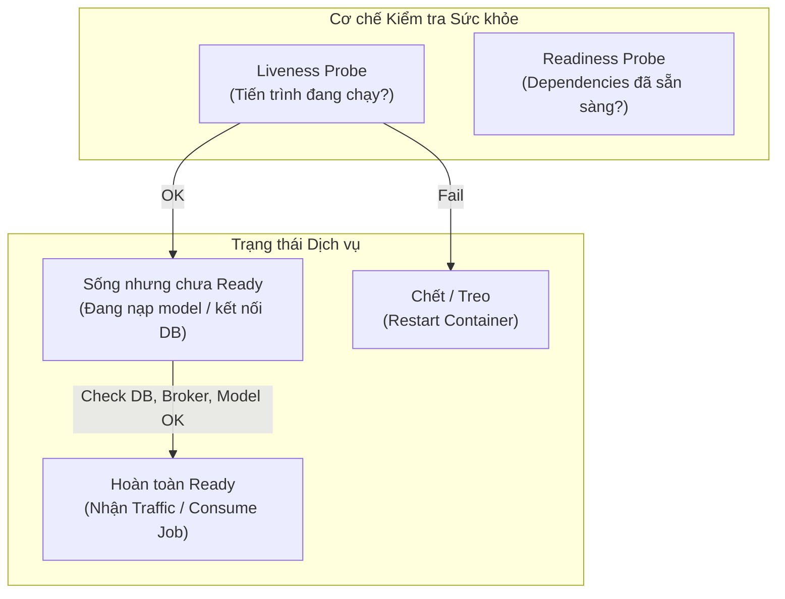

# Bàn giao Môi trường Tích hợp Sprint 3 & Sổ tay Vận hành Khởi động

> **Dự án**: AURA (SP26SE025) · Retinal Vascular Health Screening
> **Mã công việc Jira**: **SCRUM-318** (`[W3]M1] Dựng môi trường tích hợp riêng và kiểm tra khởi động`)
> **Người thực hiện (M1)**: Nguyễn Trương Hậu (Lead Architecture / Platform / DevOps)
> **Bên tiếp nhận**: Toàn đội phát triển (M2 - Analysis, M3 - Billing, M4 - AI, M5 - Web, M6 - Identity/Profile)
> **Trạng thái xác thực**: **PASS (Đã kiểm định qua PASS87C, PASS87S)**
> **Bằng chứng hệ thống**: `C:\Users\nguye\Downloads\A87C\epoch-checkpoint87C.json` và `C:\Users\nguye\Downloads\A87S\postgres-sandbox-journal87S.json`

---

## 1. Mục đích và Phạm vi bàn giao

Môi trường tích hợp Sprint 3 được thiết kế tách biệt hoàn toàn khỏi các dữ liệu mẫu cũ (fixture 08), vận hành độc lập trên Docker với ngân sách tài nguyên được giới hạn nghiêm ngặt (resource-bounded), kiểm soát an ninh đa tầng (non-root execution, read-only rootfs, Unix Domain Sockets).

Tài liệu này cung cấp:
1. Danh mục 7 container dịch vụ nền tảng đang chạy thực tế.
2. Ngân sách tài nguyên (RAM, CPU, Disk) đã được kiểm chứng.
3. Cơ chế phân biệt **Liveness** và **Readiness Probes** cho từng service.
4. Quy trình khởi động lại có kiểm soát (Safe Reboot & Recovery Runbook).

---

## 2. Danh mục 7 Dịch vụ Nền tảng Đang Hoạt động

| TT | Container Name | Container ID | Hình ảnh / Công nghệ | Vai trò trong hệ thống | Cổng kết nối / Socket | Trạng thái |
|:---:|---|---|---|---|---|:---:|
| 1 | `aura-pg87s-c4fdb65507bd41d9` | `5e981a2f0c07` | PostgreSQL 17.11 (Alpine 3.24) | Sandbox DB cô lập cho Migration | Unix Socket `/var/run/postgresql` (70:70, mode 0700) | **Up (healthy)** |
| 2 | `aura-identity81-7ed83e5b3fdc44de`| `115bc55e10a4` | Identity Service (.NET 10) | Phát hành JWT Token (RSA 3072) | Nội bộ Docker network | **Up (healthy)** |
| 3 | `aura-ai77-539ab735c32d401c` | `f462be1979e5` | AI Core Service (FastAPI) | Thuật toán Frangi v0.2 phân tích mạch máu | Port `8000/tcp` (`/health`, `/ready`) | **Up (healthy)** |
| 4 | `aura-lab51-ac28e39b2b59-rabbitmq`| `ca92c7faac29` | RabbitMQ 4.3.6 (Quorum Cluster) | Topology Quorum 11 queues, DLQ & TTL | Cụm nội bộ | **Up** |
| 5 | `aura-s3-rabbitmq-1` | `78c20ad19277` | RabbitMQ 4.3.6 Broker Core | Broker chính điều phối sự kiện | AMQP `5672`, Mgmt `127.0.0.1:15372` | **Up** |
| 6 | `aura-s3-nifi-1` | `fb96195296a1` | Apache NiFi Ingestion | Thu nhận ảnh từ Camera Fundus | HTTPS `127.0.0.1:8543` | **Up** |
| 7 | `aura-s3-reporting-postgres-1` | `d48af9573817` | PostgreSQL 17 Reporting Core | Cơ sở dữ liệu lưu trữ 2 receipts hợp lệ | Port `5432/tcp` | **Up** |

---

## 3. Ngân sách Tài nguyên Đã Được Đo lường (Capacity Planning)

Theo kết quả kiểm tra tự động tại `CAPACITY87S`:
- **CPU**: 12 Logical Cores.
- **Tổng dung lượng RAM máy ảo (VM)**: `5,780.8 MiB` (~5.65 GiB).
- **RAM còn khả dụng thực tế**: `3,754.59 MiB` (~3.66 GiB).
- **Ngưỡng an toàn tối thiểu (Floor)**: `1,792 MiB` (đảm bảo chạy đủ AI Frangi + PostgreSQL Sandbox + RabbitMQ Broker + .NET Backend mà không gây OOMKilled).
- **Bộ nhớ đệm PostgreSQL Sandbox**: Giới hạn `tmpfs` 128MB cho dữ liệu, 16MB cho `/tmp`, 8MB cho socket.
- **Dung lượng ổ đĩa khả dụng**: > `40 GiB` trên phân vùng package drive, > `900 GiB` trên VM filesystem (vượt xa mức tối thiểu 8.5 GiB cần thiết).

---

## 4. Đặc tả Liveness và Readiness Probes

Mọi service khi tích hợp vào môi trường Sprint 3 phải phân biệt rõ giữa liveness (tiến trình còn sống) và readiness (dịch vụ đã sẵn sàng phục vụ request):



### 4.1. AI Core Service (`aura-ai77-539ab735c32d401c`)
- **Liveness endpoint**: `GET http://ai-core:8000/health` -> Trả về `200 OK` (HTTP Server phản hồi).
- **Readiness endpoint**: `GET http://ai-core:8000/ready` -> Trả về `200 OK` chỉ khi:
  - Model Frangi v0.2 đã nạp vào bộ nhớ (`"engine": "frangi"`, `"model_version": "frangi-v0.2"`).
  - Khóa công khai JWT RSA đã sẵn sàng (`"jwt_verification_ready": true`).

### 4.2. RabbitMQ Broker (`aura-s3-rabbitmq-1`)
- **Liveness**: `rabbitmq-diagnostics -q ping`
- **Readiness**: `rabbitmq-diagnostics -q check_running` và kiểm tra 11 quorum queues không bị alarm memory / disk watermark.

### 4.3. PostgreSQL Sandbox (`aura-pg87s-c4fdb65507bd41d9`)
- **Liveness**: Unix socket `/var/run/postgresql/.s.PGSQL.5432` phản hồi ping peer authentication.
- **Readiness**: `SELECT 1;` và `SELECT pg_is_in_recovery();` trả về `false`.

---

## 5. Sổ tay Khởi động lại An toàn (Safe Restart & Disaster Recovery Runbook)

> [!CAUTION]
> Tuyệt đối không xóa volumes, không xóa các journal `.json` hoặc file `.claim`, không dùng cờ `--force` hoặc `docker compose down -v`.

### Bước 1: Kiểm tra trạng thái hiện tại trước khi can thiệp
```powershell
Set-Location "$env:USERPROFILE\Downloads\A87S"
py -3.12 -B .\NiFi87S.py --status
```
Kết quả kỳ vọng: `COMPLETED87S_ISOLATED_POSTGRES_READY`.

### Bước 2: Khởi động lại dịch vụ cụ thể (Ví dụ: AI Core hoặc Worker)
Nếu cần khởi động lại một dịch vụ vệ tinh (ví dụ `ai-core`):
```powershell
docker restart aura-ai77-539ab735c32d401c
```
Chờ 5 giây để model nạp xong và kiểm tra lại readiness:
```powershell
docker exec aura-ai77-539ab735c32d401c python -B -c "import urllib.request, json; print(json.loads(urllib.request.urlopen('http://127.0.0.1:8000/ready').read()))"
```

### Bước 3: Xác minh tính bất biến của dữ liệu sau khởi động
Chạy lệnh kiểm tra đọc của A87C:
```powershell
Set-Location "$env:USERPROFILE\Downloads\A87C"
py -3.12 -B .\NiFi87C.py --check
```
Xác nhận trả về: `PASS87C_CURRENT_EPOCH_VERIFIED`. Toàn bộ 2 receipt Reporting và lịch sử giao dịch được bảo toàn 100%.
