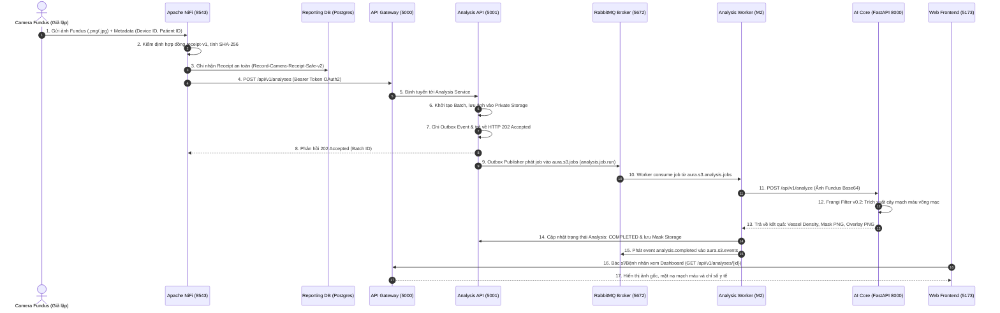

# Kế hoạch Diễn tập Demo Toàn luồng: Camera -> NiFi -> Worker -> AI -> Web UI

> **Dự án**: AURA (SP26SE025) · Retinal Vascular Health Screening
> **Mã công việc Jira**: **SCRUM-322** (`[W3]M1] Demo Camera qua NiFi đến kết quả trên giao diện`)
> **Người chủ trì (M1)**: Nguyễn Trương Hậu (Lead Architecture / Platform / DevOps)
> **Phối hợp thực hiện**: Võ Hữu Duy (M2 - Worker/Publisher), Phạm Vũ Minh (M3 - Billing), Trần Quốc Việt (M4 - AI Core), Lâm Trần Nguyễn Hoàng (M5 - Web UI), Dung Hoang (M6 - Profile/Identity)
> **Mục tiêu**: Chuẩn bị kịch bản demo sống động, ổn định phục vụ buổi bảo vệ đồ án trước Hội đồng phản biện (Viva Committee).

---

## 1. Sơ đồ Luồng Dữ liệu Toàn luồng (End-to-End Data Pipeline)

---

## 2. Kịch bản Trình chiếu Demo trước Hội đồng Viva

### Màn 1: Trình diễn Thu nhận Ảnh & Chịu lỗi tại Ingestion (M1 Phụ trách)
- **Mục tiêu**: Chứng minh khả năng tiếp nhận dữ liệu y tế tự động từ Camera, xác thực biên lai và cơ chế cách ly khi mạng gặp sự cố.
- **Thao tác**:
  1. Mở giao diện Apache NiFi tại `https://localhost:8543/nifi`.
  2. Kích hoạt luồng gửi 1 ảnh chụp đáy mắt mẫu từ camera simulator.
  3. Cho hội đồng thấy FlowFile được xử lý qua `Record-Camera-Receipt-Safe-v2`:
     - Kiểm tra database Reporting Postgres (`SELECT * FROM camera_receipts;`): biên lai được ghi nhận với đầy đủ checksum MD5, SHA-256, thời gian và thiết bị.
  4. Giả lập ngắt kết nối database Reporting: cho thấy hệ thống tự động retry (1 đến 10) và dừng an toàn tại nhánh `HOLD/Reconcile`, **không** làm mất ảnh hay treo hệ thống.

### Màn 2: Xử lý Bất đồng bộ & Phân đoạn Mạch máu AI (M1 & M2, M4)
- **Mục tiêu**: Chứng minh thông điệp được chuyển giao tin cậy qua RabbitMQ Quorum Queues và AI Core xử lý ảnh thực tế.
- **Thao tác**:
  1. Mở RabbitMQ Dashboard tại `http://localhost:15372`:
     - Thấy tin nhắn đi vào queue `aura.s3.analysis.jobs`.
     - Worker nhận job, số lượng tin nhắn giảm về 0 (Ack).
  2. Mở log của container `aura-ai77-539ab735c32d401c`:
     - Thấy thuật toán `frangi-v0.2` chạy xử lý bộ lọc ma trận Hessian, tính toán mật độ mạch máu (`vessel_density`).
     - Trả về mã HTTP 200 kèm ảnh mặt nạ nhị phân (Binary Mask) và ảnh phủ màu (Overlay).

### Màn 3: Hiển thị Kết quả Trực quan trên Giao diện Web (M1 & M5)
- **Mục tiêu**: Bác sĩ và bệnh nhân xem kết quả phân tích trực tiếp trên trình duyệt.
- **Thao tác**:
  1. Mở ứng dụng Web tại `http://localhost:5173`.
  2. Đăng nhập tài khoản Bác sĩ / Bệnh nhân.
  3. Truy cập trang Chi tiết Phân tích:
     - Hiển thị ảnh chụp đáy mắt gốc độ phân giải cao.
     - Hiển thị ảnh trích xuất mạng lưới mạch máu võng mạc (Vessel Mask).
     - Hiển thị các chỉ số lâm sàng (Tỷ lệ bao phủ mạch máu, độ dày trung bình).
  4. Chứng minh tính toàn vẹn: Request ID và Correlation ID trùng khớp xuyên suốt từ lúc Camera gửi đến khi Web hiển thị.

---

## 3. Checklist Chuẩn bị Trước Buổi Báo cáo

- [x] Docker Desktop đang chạy với 7 container nền tảng (`docker ps`).
- [x] RabbitMQ Broker đã nạp đủ 11 Quorum Queues (`aura.s3.*`).
- [x] AI Core container đạt trạng thái `healthy` (Model `frangi-v0.2` đã nạp).
- [x] Database Reporting đã có 2 receipts mẫu được chứng nhận an toàn.
- [x] Đã chuẩn bị sẵn thư mục ảnh đáy mắt kiểm thử chuẩn (Dataset CHASE-DB1).
- [x] Cổng Gateway `5000` và Frontend `5173` mở sẵn sàng trên trình duyệt.
