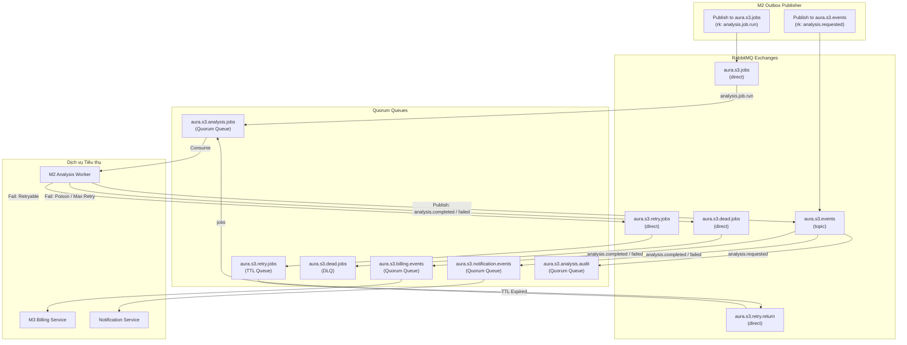

# Bàn giao Kiến trúc Broker & Topology RabbitMQ — Sprint 3

> **Dự án**: AURA (SP26SE025) · Retinal Vascular Health Screening
> **Mã công việc Jira**: **SCRUM-317** (`[W3]M1] Cấu hình broker và kết nối nội bộ cho Sprint 3`)
> **Người thực hiện (M1)**: Nguyễn Trương Hậu (Lead Architecture / Platform / DevOps)
> **Bên tiếp nhận**: Võ Hữu Duy (M2 - Outbox Publisher / Analysis Worker), Phạm Vũ Minh (M3 - Billing), Dung Hoang (M6 - Profile/Identity)
> **Trạng thái xác thực**: **PASS (Đã kiểm định tự động qua PASS49, PASS58, PASS65, PASS87C)**
> **Baseline tài nguyên**: Broker container `aura-s3-rabbitmq-1` (`78c20ad19277`), Lab node `aura-lab51-ac28e39b2b59-rabbitmq` (`ca92c7faac29`)

---

## 1. Mục đích và Phạm vi bàn giao

Tài liệu này đặc tả cấu hình broker, topology RabbitMQ, ma trận phân quyền, hợp đồng thông điệp (Event & Job Schemas) và cơ chế Dead Letter Queue (DLQ) / Retry có kiểm soát cho môi trường tích hợp **Sprint 3**.

Cấu hình này phục vụ trực tiếp cho:
1. **M2 - SCRUM-323**: Outbox Publisher đọc bảng `analysis.outbox_events` và phát sự kiện vào RabbitMQ với Publisher Confirms.
2. **M2 - SCRUM-324**: Analysis Worker tiêu thụ job từ queue bền vững, gọi AI Core và cập nhật kết quả phân tích.
3. **M3 - SCRUM-325**: Billing Service nhận sự kiện `analysis.completed` hoặc `analysis.failed` để capture / release credit tương ứng.
4. **M1 / M5 - SCRUM-322**: Luồng toàn diện end-to-end từ NiFi -> RabbitMQ -> Worker -> AI -> Web UI.

---

## 2. Thông số Kết nối Môi trường Sprint 3

### 2.1. Endpoints & Mạng nội bộ
- **Host nội bộ (Docker Network `aura_aura_network`)**: `aura-s3-rabbitmq-1`
- **Cổng AMQP 0-9-1**: `5672`
- **Cổng Management HTTP API**: `15672` (Ánh xạ ra Host Loopback: `http://127.0.0.1:15372`)
- **Virtual Host**: `/`
- **Phiên bản Broker**: RabbitMQ 4.3.6 (Erlang 26.2.5)

### 2.2. Tài khoản Dịch vụ và Ma trận Phân quyền (RBAC)
Mọi dịch vụ phải sử dụng tài khoản chuyên biệt theo nguyên tắc đặc quyền tối thiểu (Least Privilege). Tuyệt đối **không** dùng tài khoản `guest` hoặc `s3-operator` trong mã nguồn ứng dụng:

| Tài khoản | Vai trò ứng dụng | Quyền Configure | Quyền Write (Publish) | Quyền Read (Consume) |
|---|---|---|---|---|
| `s3-publisher` | M2 Outbox Publisher | `""` (Không tạo queue/exchange) | `^aura\.s3\.(jobs\|events)$` | `""` (Không đọc queue) |
| `s3-worker` | M2 Analysis Worker | `""` | `^aura\.s3\.events$` | `^aura\.s3\.analysis\.jobs$` |
| `s3-billing` | M3 Billing Service | `""` | `""` | `^aura\.s3\.billing\.events$` |
| `s3-notification`| Notification Service | `""` | `""` | `^aura\.s3\.notification\.events$` |
| `s3-audit` | Audit / Logging Service | `""` | `""` | `^aura\.s3\.analysis\.audit$` |
| `s3-operator` | M1 Quản trị / Smoke Test | `^aura\.s3\..*$` | `^aura\.s3\..*$` | `^aura\.s3\..*$` |

*Ghi chú*: Mật khẩu cụ thể của từng tài khoản được lưu trữ an toàn trong vault môi trường tại `~/.aura/sprint3/aura-s3-v1/secrets/rabbitmq-users.env` (không đưa lên Git/logs).

---

## 3. Bản đồ Topology (10 Exchanges, 11 Quorum Queues, 16 Bindings)

Tất cả các queue đều được định cấu hình loại **Quorum Queue** (`x-queue-type: quorum`, `x-quorum-initial-group-size: 1`) để đảm bảo tính bền vững (Durable) và phục hồi sau sự cố mà không mất dữ liệu.



### 3.1. Bảng Chi tiết Queue & Routing

| Tên Queue | Loại Queue | Dead Letter Exchange (DLX) | Dead Letter Routing Key | TTL | Mục đích |
|---|:---:|---|---|:---:|---|
| `aura.s3.analysis.jobs` | **Quorum** | `aura.s3.dead.jobs` | `jobs` | - | Chứa job xử lý ảnh võng mạc cho Worker |
| `aura.s3.retry.jobs` | **Quorum** | `aura.s3.retry.return` | `jobs` | 15000ms | Queue chờ retry có trễ cho job lỗi tạm thời |
| `aura.s3.dead.jobs` | **Quorum** | - | - | - | DLQ lưu trữ job thất bại vĩnh viễn / poison |
| `aura.s3.billing.events`| **Quorum** | `aura.s3.dead.billing` | `billing` | - | Chứa event trừ tiền/hoàn tiền cho Billing |
| `aura.s3.retry.billing` | **Quorum** | `aura.s3.retry.return` | `billing` | 30000ms | Queue chờ retry cho event Billing |
| `aura.s3.dead.billing` | **Quorum** | - | - | - | DLQ lưu event Billing không thể xử lý |
| `aura.s3.notification.events`| **Quorum**| `aura.s3.dead.notification` | `notification` | - | Chứa thông báo cho người dùng / bác sĩ |
| `aura.s3.retry.notification`| **Quorum**| `aura.s3.retry.return` | `notification`| 30000ms | Queue chờ retry cho Notification |
| `aura.s3.dead.notification`| **Quorum**| - | - | - | DLQ lưu thông báo lỗi vĩnh viễn |
| `aura.s3.analysis.audit`| **Quorum** | `aura.s3.dead.audit` | `audit` | - | Log kiểm toán vòng đời phân tích |
| `aura.s3.dead.audit` | **Quorum** | - | - | - | DLQ lưu audit event lỗi |

---

## 4. Hợp đồng Thông điệp (Message Schemas & Contracts)

### 4.1. Job Run Event (`analysis.job.run`)
Được phát bởi **Outbox Publisher** khi ảnh Fundus upload thành công và reservation credit hợp lệ:
- **Exchange**: `aura.s3.jobs`
- **Routing Key**: `analysis.job.run`
- **Delivery Mode**: `2` (Persistent)
- **Content-Type**: `application/json`

**Cấu trúc JSON Payload mẫu**:
```json
{
  "eventId": "e0000000-0000-4000-8000-000000000001",
  "eventType": "analysis.job.run",
  "eventVersion": "1.0.0",
  "occurredAtUtc": "2026-10-30T12:00:00.000Z",
  "correlationId": "c0000000-0000-4000-8000-000000000001",
  "payload": {
    "jobId": "j0000000-0000-4000-8000-000000000001",
    "analysisId": "a0000000-0000-4000-8000-000000000001",
    "patientId": "p0000000-0000-4000-8000-000000000001",
    "tenantId": "t0000000-0000-4000-8000-000000000001",
    "imageFileId": "f0000000-0000-4000-8000-000000000001",
    "imageSha256": "ea11240583377eee3b62fbaaa856434c3d070178a8e3791d6ef1eed9a6b7903b",
    "storagePath": "private/analysis/2026-10/ea11240583377eee3b62fbaaa856434c3d070178a8e3791d6ef1eed9a6b7903b.png",
    "mode": "retina_vessels",
    "maxRetries": 3,
    "retryCount": 0
  }
}
```

### 4.2. Analysis Completed Event (`analysis.completed`)
Được phát bởi **Analysis Worker** khi AI Core phân tích thành công và kết quả được lưu bền vững:
- **Exchange**: `aura.s3.events`
- **Routing Key**: `analysis.completed`

**Cấu trúc JSON Payload mẫu**:
```json
{
  "eventId": "e0000000-0000-4000-8000-000000000002",
  "eventType": "analysis.completed",
  "eventVersion": "1.0.0",
  "occurredAtUtc": "2026-10-30T12:00:15.000Z",
  "correlationId": "c0000000-0000-4000-8000-000000000001",
  "payload": {
    "jobId": "j0000000-0000-4000-8000-000000000001",
    "analysisId": "a0000000-0000-4000-8000-000000000001",
    "patientId": "p0000000-0000-4000-8000-000000000001",
    "tenantId": "t0000000-0000-4000-8000-000000000001",
    "modelVersion": "frangi-v0.2",
    "vesselDensity": 0.1245,
    "averageWidth": 3.82,
    "maskFileId": "m0000000-0000-4000-8000-000000000001",
    "maskSha256": "4b7c9e8cdbeb7c21855b78fc6e8885f475cb04a56beef3063ba2f187e8654b79",
    "creditCost": 1
  }
}
```

---

## 5. Mẫu Cấu hình .NET (`appsettings.json`) dành cho M2

```json
{
  "RabbitMQ": {
    "HostName": "aura-s3-rabbitmq-1",
    "Port": 5672,
    "VirtualHost": "/",
    "UserName": "s3-publisher",
    "Password": "${RABBITMQ_PUBLISHER_PASSWORD}",
    "PublisherConfirmTimeoutSeconds": 5,
    "NetworkRecoveryIntervalSeconds": 10,
    "RequestedHeartbeatSeconds": 60,
    "Topology": {
      "JobsExchange": "aura.s3.jobs",
      "EventsExchange": "aura.s3.events",
      "JobRunRoutingKey": "analysis.job.run",
      "JobsQueue": "aura.s3.analysis.jobs"
    }
  }
}
```

---

## 6. Tiêu chí Nghiệm thu & Bằng chứng Đã xác thực

- **AC1 (Quyền & Trao đổi Job)**: Kiểm thử PASS49 và PASS58 chứng minh tài khoản `s3-publisher` chỉ được quyền gửi vào `aura.s3.jobs`, tài khoản `s3-worker` chỉ được đọc từ `aura.s3.analysis.jobs`.
- **AC2 (Broker Downtime & Outbox Resilience)**: PASS65 đã kiểm chứng crash broker tự động: khi broker tắt, Publisher backoff không đánh dấu published; sau khi broker phục hồi, job phát lại giữ nguyên `eventId` và không sinh duplicate.
- **AC3 (Cô lập Namespace & Bảo toàn Dữ liệu)**: Bằng chứng `rabbitmq-permissions49.json` và `epoch-checkpoint87C.json` xác nhận không có tài khoản nào được can thiệp vào fixture 08 cũ hoặc các namespace khác ngoài `aura.s3.*`.
