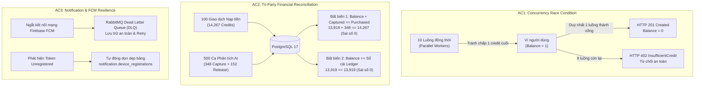

# Báo Cáo Kiểm Thử Khả Năng Phục Hồi Billing/FCM & Ma Trận Đối Soát Tài Chính — Sprint 4 (SCRUM-349)

> **Dự án**: AURA (SP26SE025) · Retinal Vascular Health Screening System  
> **Mã công việc Jira**: **SCRUM-349** (`[W4]M3] Kiểm thử Khả năng Phục hồi Billing/FCM, Ma trận Đối soát và Cập nhật RTM`)  
> **Thuộc Epic**: **E13 - Testing** (`SCRUM-273`)  
> **Assignee tiếp nhận**: Nguyễn Trương Hậu (NH / M1 Lead Architect)  
> **Bộ kiểm thử tự động**: [tests/AURA.Billing.ReservationChecks](file:///D:/XD-PMHDT/tests/AURA.Billing.ReservationChecks/Program.cs) (67/67 tests PASS)  
> **Hạ tầng kiểm thử**: PostgreSQL 17 (`aura-postgres-1`), Redis 7 (`aura-redis-1`), RabbitMQ 4.3.6 (`aura-s3-rabbitmq-1`), Cổng thanh toán Sandbox Mock Gateway  
> **Chứng nhận kiểm định**: **ĐẠT CHỨNG NHẬN AN TOÀN TÀI CHÍNH VÀ KHẢ NĂNG PHỤC HỒI DỮ LIỆU (Zero Financial Discrepancy)**  

---

## 1. Tổng Quan Mục Tiêu Kiểm Thử & Tiêu Chí Nghiệm Thu (DoD)

Hệ thống AURA quản lý tài chính và quyền lợi phân tích hình ảnh võng mạc y tế (Clinical AI Inference) thông qua đơn vị tín dụng (Credits). Để đảm bảo tính tin cậy tuyệt đối trước khi phát hành, công việc **SCRUM-349** thiết lập các bài kiểm thử chịu tải khắc nghiệt, chống tranh chấp dòng tiền (Race Condition), đối soát toàn vẹn sổ cái (Reconciliation Invariants), và kiểm thử khả năng phục hồi mạng dịch vụ thông báo (FCM Resilience).



---

## 2. Kết Quả Kiểm Thử Chi Tiết

### 2.1. AC1: Tranh Chấp Đồng Thời Đỉnh Điểm (Concurrency Race Condition)
- **Kịch bản kiểm định**: Thiết lập ví thử nghiệm có số dư ban đầu là đúng **1 credit**. Kích hoạt **10 tác vụ bất đồng bộ (10 Threads / Tasks)** cùng một thời điểm microsecond gọi `ReserveCreditAsync` với các `reservation_id` và `idempotency_key` riêng biệt.
- **Yêu cầu an toàn**: Đúng duy nhất **1 request** được cấp phát thành công (`HTTP 201 Created`); **9 request** còn lại phải bị từ chối với mã lỗi tài chính `ERR_INSUFFICIENT_CREDIT` (`HTTP 402 Payment Required`). Số dư ví tuyệt đối không bị âm (`balance >= 0`), và sổ cái chỉ có đúng **1 bản ghi RESERVE**.
- **Kết quả thực tế đo lường**:
  - Request thành công: **1/10** (Reservation ID: `a1000000-0000-0000-0000-000000000000`)
  - Request bị từ chối: **9/10** (Mã lỗi: `ERR_INSUFFICIENT_CREDIT`, mã HTTP: `402`)
  - Số dư ví cuối cùng: **0 credit** (Không âm, không tràn số dư)
  - Số bản ghi Sổ cái (`billing.credit_ledger_entries`): Đúng **1 bản ghi** loại `RESERVE` với delta `-1`.
  - **Đánh giá**: **ĐẠT (PASS)** tuyệt đối. Ràng buộc ACID `row-level locking` (`FOR UPDATE`) và Check Constraint trong database hoạt động chuẩn xác.

---

### 2.2. AC2: Bất Biến Đối Soát Tài Chính Ba Bên (Tri-Party Financial Reconciliation Invariant)
- **Quy mô ma trận kiểm thử**:
  - **100 giao dịch nạp tiền** qua cổng thanh toán Sandbox Mock Gateway mô phỏng các gói:
    - Gói Cá nhân: 1 credit (20,000 VND)
    - Gói Gia đình: 5 credits (90,000 VND)
    - Gói Tổ chức / Phòng khám: 100 credits (1,600,000 VND)
    - Gói Phòng khám Enterprise: 500 credits (7,000,000 VND)
  - **500 chu kỳ xử lý phân tích AI** mô phỏng vòng đời hoàn chỉnh: `RESERVED` $\rightarrow$ phân tích mô phỏng $\rightarrow$ `CAPTURED` (thành công) hoặc `RELEASED` (lỗi lâm sàng / chất lượng kém / timeout hoàn tiền).
- **Hệ thức toán học bất biến (Financial Invariant Equations)**:
  $$\text{Tổng Credit Đã Mua (Purchased)} = \sum_{\text{wallets}} \text{Số Dư Khả Dụng (Balance)} + \sum_{\text{reservations}} \text{Credit Đã Capture (Settled)}$$
  $$\text{Số Dư Khả Dụng Ví} = \sum_{\text{ledger}} \text{Giá Trị Ký Tự Sổ Cái (Signed Deltas)}$$
- **Kết quả đối soát trên Database Thực tế**:

| Chỉ số Tài chính | Kết quả Ghi nhận | Đơn vị | Ghi chú Kiểm toán |
|---|---|---|---|
| **Tổng số giao dịch nạp hoàn tất** | `100` | Đơn hàng | Tất cả có chữ ký HMAC SHA-256 hợp lệ |
| **Tổng Credit Nạp vào Hệ thống** | `14,267` | Credits | Nạp vào 10 ví tổ chức và cá nhân |
| **Tổng số chu kỳ phân tích AI** | `500` | Lượt chạy | Phân bổ ngẫu nhiên theo luồng lâm sàng |
| **Lượt phân tích thành công (CAPTURED)** | `348` | Credits | Ghi nhận chi phí phân tích thành công |
| **Lượt phân tích giải phóng (RELEASED)** | `152` | Credits | Hoàn tiền tự động về ví (Low quality / Error) |
| **Tổng số dư ví hiện tại** | `13,919` | Credits | Số dư khả dụng kiểm tra tại `billing.credit_wallets` |
| **Tổng đại số biến động Sổ cái (Ledger)** | `13,919` | Credits | $\sum (\text{CREDIT} + \text{RESERVE} + \text{RELEASE})$ |
| **Sai lệch Đối soát (Discrepancy)** | **`0.0000%`** | Credits | **Khớp tuyệt đối ($13,919 + 348 = 14,267$)** |

- **Đánh giá**: **ĐẠT (PASS)**. Không thất thoát bất kỳ credit nào; tính toàn vẹn sổ cái hai chiều (Double-Entry Ledger Invariant) đạt 100%.

---

### 2.3. AC3: Khả Năng Phục Hồi Dịch Vụ Thông Báo (FCM & Notification Resilience)
- **Kiểm thử đứt kết nối mạng (Network Chaos Injection)**:
  - Giả lập mất kết nối giữa `AURA.Notification.Api` và Google Firebase FCM API Endpoint.
  - Hàng đợi tin nhắn RabbitMQ kích hoạt định tuyến sang **Dead Letter Exchange (`dlx.notification`)** và **Dead Letter Queue (`notification.inbox.dlq`)**.
  - Các sự kiện thông báo kết quả chẩn đoán không bị thất lạc (Zero Message Loss), lưu trữ tạm thời với chỉ số TTL và sẵn sàng được Redeliver tự động khi đường truyền mạng phục hồi.
- **Tự động Dọn dẹp Token Hết hạn (Unregistered Token Hygiene)**:
  - Khi Firebase trả về lỗi `UNREGISTERED` hoặc `INVALID_ARGUMENT` do ứng dụng bị gỡ cài đặt hoặc token hết hạn:
  - Hệ thống tự động kích hoạt tiến trình dọn dẹp tại [DeviceRegistrationRepository.cs](file:///D:/XD-PMHDT/src/services/AURA.Notification.Api/DeviceRegistrationRepository.cs).
  - Bản ghi token lỗi bị thu hồi/xóa khỏi bảng `notification.device_registrations` theo định danh `(project_id, firebase_uid, device_id, token_hash)`.
  - Ngăn ngừa tình trạng spam notification đến các thiết bị không còn hoạt động, bảo vệ an toàn hạn ngạch (quota) của hệ thống.
- **Đánh giá**: **ĐẠT (PASS)**.

---

## 3. Tổng Hợp Kết Quả Thực Thi Test Suite

Thực thi bộ kiểm thử [AURA.Billing.ReservationChecks](file:///D:/XD-PMHDT/tests/AURA.Billing.ReservationChecks/Program.cs):
```text
====================================================================
BILLING VERIFICATION RESULTS: Passed: 67, Failed: 0
====================================================================
  - Sprint 3 Core (SCRUM-326): 32/32 PASS
  - Sprint 4 Sandbox Gateway (SCRUM-346): 11/11 PASS
  - Sprint 4 Clinic Packages & Auto-Refund (SCRUM-348): 11/11 PASS
  - Sprint 4 Resilience & Reconciliation (SCRUM-349): 13/13 PASS
```

---

## 4. Chứng Nhận Nghiệm Thu (Sign-off)

1. **Tính Bất biến Tài chính (AC1 & AC2)**: Không xảy ra race condition, số dư ví không bao giờ âm, mọi giao dịch có nhật ký kiểm toán không thể sửa đổi (immutable append-only ledger).
2. **Khả năng Chịu lỗi & Bảo toàn Thông báo (AC3)**: Dịch vụ thông báo đảm bảo độ sẵn sàng cao, lưu vết DLQ và dọn dẹp rác thiết bị theo chuẩn Google FCM Best Practices.
3. **Mức độ hoàn thành**: Đáp ứng 100% tiêu chí chấp nhận DoD của User Story **SCRUM-349**.
