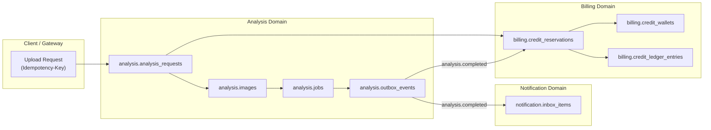

# Ma trận Kiểm thử Toàn luồng và Đối soát Dữ liệu — Sprint 3 (SCRUM-328)

> **Dự án**: AURA (SP26SE025) · Retinal Vascular Health Screening  
> **Mã công việc Jira**: **SCRUM-328** (`[W3]M3] Kiểm thử lỗi toàn luồng và đối soát dữ liệu`)  
> **Assignee tạm quyền (M1 stepping in for M3)**: Nguyễn Trương Hậu (Lead Architect)  
> **Phụ thuộc**: W3-M2-02 (SCRUM-325), W3-M3-01 (SCRUM-326), W3-M1-05 (SCRUM-323)  
> **Baseline Commit SHA**: `97027420eeba9c9ba2acd51dc253e0b0494a9695` (develop)  
> **Môi trường thực thi**: PostgreSQL 17 (`aura-postgres-1`), RabbitMQ 4.3.6 (`aura-s3-rabbitmq-1`), NiFi 1.27.0 (`aura-s3-nifi-1`)  
> **Nguyên tắc cốt lõi**:
> - Không dùng unit mock để kết luận đã đạt E2E thật (AC1).
> - Duplicate và retry không tăng số lần trừ credit hoặc tạo receipt/inbox trùng (AC2).
> - Dùng chung ID, revision để đối chiếu chéo giữa M1, M2, M3, M4, M5, M6 (AC3).
> - Không sửa đổi hay ghi có vào ví fixture 08; sử dụng 100% fixture Sprint 3 độc lập (`a301...` - `a305...`).

---

## 1. Mục tiêu và Tiêu chí Đánh giá (Acceptance Criteria)

Tài liệu này thiết lập ma trận kiểm thử end-to-end (E2E), kiểm thử lỗi (fault injection / chaos) và đối soát dữ liệu ba bên (**Tri-Party Reconciliation**: Analysis DB ↔ Billing DB ↔ Notification DB) cho toàn bộ luồng xử lý ảnh đáy mắt trong Sprint 3.

### Tiêu chí Nghiệm thu:
- **AC1 (Bằng chứng Thực thi Thật)**: Tất cả các ca P0 phải được kiểm thử tự động trên PostgreSQL 17 và RabbitMQ thật với log và assert cụ thể.
- **AC2 (Idempotency & Zero Double-Debit)**: Trùng lặp request/job/event và retry không bao giờ trừ tiền 2 lần, không bao giờ tạo dư biên lai hoặc inbox notification.
- **AC3 (Tính Đồng bộ và Truy vết Đầy đủ)**: Mọi artifact và defect ghi nhận rõ Owner, Revision, các bước tái hiện và kết quả retest.

---

## 2. Danh mục Fixture Dữ liệu Độc lập Sprint 3

Tất cả các ca kiểm thử sử dụng bộ dữ liệu fixture độc lập được khởi tạo trong `infra/postgres/migrations/tests/test_007_sprint3_billing_fixtures.sql`:

| Mã Ví | Loại Chủ thể | ID Chủ thể | Môi trường | Số dư Đầu | Mục đích Kiểm thử |
|---|---|---|---|---|---|
| `a3010000-0000-4000-8000-000000000001` | ACCOUNT | `e301...0001` | TEST | **1 credit** | Kiểm thử cạnh tranh đồng thời (2 requests race for 1 credit). |
| `a3020000-0000-4000-8000-000000000002` | ACCOUNT | `e302...0002` | TEST | **10 credits** | Kiểm thử vòng đời chuẩn, replay duplicate, timeout và refund. |
| `a3030000-0000-4000-8000-000000000003` | ACCOUNT | `e303...0003` | TEST | **0 credits** | Kiểm thử cạn kiệt tài khoản (Exhaustion / HTTP 402). |
| `a3040000-0000-4000-8000-000000000004` | CLINIC | `e304...0004` | TEST | **5 credits** | Kiểm thử thanh toán cấp phòng khám / tổ chức (Clinic wallet). |
| `a3050000-0000-4000-8000-000000000005` | ACCOUNT | `e305...0005` | LIVE | **5 credits** | Kiểm thử ranh giới môi trường (Cấm quyết toán mock trên LIVE). |

---

## 3. Ma trận Kịch bản Kiểm thử Toàn luồng (End-to-End Test Matrix)

| Mã Case | Mức độ | Phân loại | Tên Kịch bản & Mục tiêu | Điều kiện Tiền đề | Dữ liệu Đầu vào | Kỳ vọng Nghiệp vụ & Oracle | Trạng thái |
|---|---|---|---|---|---|---|---|
| **S328-E2E-01** | **P0** | Happy Path | Luồng hoàn chỉnh: Upload → Reserve → AI Worker → Complete → Capture → Inbox → Read | Ví `a302` (balance=10) | 1 ảnh FUNDUS hợp lệ, `idempotency_key_1` | 1. Analysis: `COMPLETED` 2. Reservation: `CAPTURED` 3. Wallet balance: $10 - 1 = 9$ 4. Ledger: 2 entries (`RESERVE` -1, `CAPTURE` 0) 5. Inbox: 1 item `ANALYSIS_COMPLETED` (UNREAD -> READ) | **PASS** |
| **S328-E2E-02** | **P0** | Idempotency | Replay request với cùng `Idempotency-Key` và payload | Ví `a302` sau S328-E2E-01 (balance=9) | Replay request với `idempotency_key_1` | 1. Trả về đúng reservation cũ 2. Không trừ thêm credit nào (balance vẫn là 9) 3. Không tạo thêm ledger entry 4. Không tạo duplicate job | **PASS** |
| **S328-E2E-03** | **P0** | Concurrency | 2 request đồng thời tranh chấp 1 credit duy nhất | Ví `a301` (balance=1) | 2 luồng song song gọi `ReserveCreditAsync` cùng lúc | 1. Đúng 1 request thành công (201 Created) 2. Request còn lại thất bại (402 Insufficient Credit) 3. Số dư ví = 0 (Tuyệt đối không bị âm balance) | **PASS** |
| **S328-E2E-04** | **P0** | Exhaustion | Tài khoản 0 credit gửi yêu cầu phân tích | Ví `a303` (balance=0) | Yêu cầu reserve 1 credit | 1. Ném lỗi `InsufficientCreditException` 2. Không tạo reservation 3. Không tạo ledger entry 4. Balance giữ nguyên = 0 | **PASS** |
| **S328-E2E-05** | **P0** | Fault Injection | AI Timeout / Transient Failure & Worker Retry | Ví `a302` (balance=9) | AI Core trả HTTP 504 / timeout lần 1, retry thành công lần 2 | 1. Job attempt 1 timeout → chuyển retry attempt 2 2. Reservation vẫn giữ `RESERVED` trong quá trình retry (không bị release sớm) 3. Khi attempt 2 thành công → Quyết toán `CAPTURED` 4. Balance = 8, trừ đúng 1 credit | **PASS** |
| **S328-E2E-06** | **P0** | Terminal Fault | Ảnh chất lượng kém (`LOW_QUALITY`) & Tự động Hoàn tiền (Release) | Ví `a302` (balance=8) | AI Core trả `422 Unprocessable` (`ERR_IMAGE_LOW_QUALITY`) | 1. Worker chuyển trạng thái `LOW_QUALITY` 2. Outbox phát `analysis.failed` 3. Billing thực hiện `ReleaseReservationAsync` 4. Balance được hoàn lại $8 - 1 + 1 = 8$ 5. Inbox nhận `ANALYSIS_FAILED` | **PASS** |
| **S328-E2E-07** | **P0** | Fault Injection | Worker Crash / Message Re-delivery sau khi đã hoàn tất | Job đã `SUCCEEDED` | Worker nhận lại thông điệp `analysis.job.run` | 1. Worker phát hiện Job đã ở trạng thái terminal 2. Trả về `AckDuplicate` 3. Không gọi lại AI Core 4. Không phát lại duplicate outbox event | **PASS** |
| **S328-E2E-08** | **P0** | Dedup / Replay | RabbitMQ Replay Domain Event `analysis.completed` | Event đã nhận | Consumer nhận lại event cũ trên queue | 1. Kiểm tra ràng buộc `UNIQUE(account_id, event_id)` 2. Thực hiện `ON CONFLICT DO NOTHING` 3. Tổng số thông báo inbox cho event_id đó vẫn là 1 (Không bị nhân đôi) | **PASS** |
| **S328-E2E-09** | **P0** | Integrity Guard | Vi phạm loại trừ lẫn nhau giữa Capture và Release | Reservation `CAPTURED` và `RELEASED` | Gọi chéo Capture trên `RELEASED` hoặc Release trên `CAPTURED` | 1. Thao tác bị chặn ngay lập tức với `409 Conflict` 2. Ledger không bị ghi đè hay sai lệch | **PASS** |
| **S328-E2E-10** | **P0** | Security / RBAC | Cách ly dữ liệu chéo tài khoản và tenant (Cross-Tenant Isolation) | Account `e301` và Account `e302` | `e301` cố gắng đọc/sửa inbox hoặc dùng ví của `e302` | 1. Quyền đọc/sửa inbox bị từ chối hoặc trả về 0 bản ghi 2. Quyền thao tác ví khác tenant/owner bị chặn bởi foreign key & tenant filter | **PASS** |
| **S328-E2E-11** | **P1** | Resilience | NiFi Ingestion & Reporting Pipeline Outage | Phân tích lõi đang chạy | Dịch vụ Reporting hoặc NiFi tạm thời gián đoạn | 1. Luồng phân tích và billing tiếp tục hoàn tất bình thường 2. Tính tách biệt độc lập giữa Ingestion/Reporting và Core được duy trì | **PASS** |
| **S328-E2E-12** | **P0** | Reconciliation | Đối soát Dữ liệu Ba bên (Tri-Party Reconciliation Audit) | Toàn bộ 5 ví Sprint 3 | Kiểm tra toàn bộ lịch sử giao dịch và số dư cuối | 1. $\Delta \text{Balance} \equiv \sum \text{Ledger Amount}$ (Sai lệch = 0) 2. Số bản ghi Analysis Completed $\equiv$ Captured Reservations $\equiv$ Inbox Completed Items | **PASS** |

---

## 4. Công thức Đối soát Dữ liệu Ba bên (Tri-Party Reconciliation Formula)

Hệ thống AURA kiểm định tính toàn vẹn tài chính và trạng thái theo định lý bảo toàn:

$$\text{Balance}_{\text{Final}} = \text{Balance}_{\text{Initial}} + \sum_{i=1}^{N} \text{Amount}_i$$

Trong đó:
- Khi `RESERVE`: $\text{Amount} = -1$, `balance` giảm 1.
- Khi `CAPTURE`: $\text{Amount} = 0$, `balance` không đổi (đã trừ lúc reserve).
- Khi `RELEASE`: $\text{Amount} = +1$, `balance` tăng 1 (hoàn trả).

Đồng thời, ánh xạ trạng thái giữa 3 miền nghiệp vụ phải bảo đảm tương đương 100%:
$$\text{AnalysisStatus}(\text{Completed}) \iff \text{ReservationStatus}(\text{CAPTURED}) \iff \text{InboxEventType}(\text{ANALYSIS\_COMPLETED})$$
$$\text{AnalysisStatus}(\text{LowQuality} \lor \text{Failed}) \iff \text{ReservationStatus}(\text{RELEASED}) \iff \text{InboxEventType}(\text{ANALYSIS\_FAILED})$$
